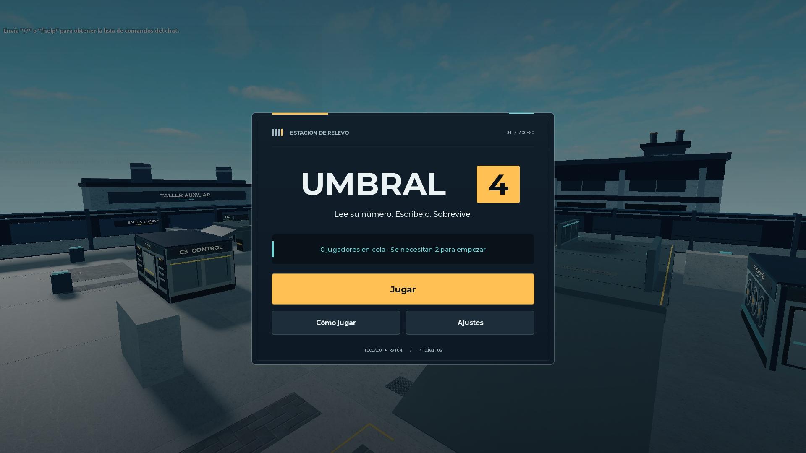
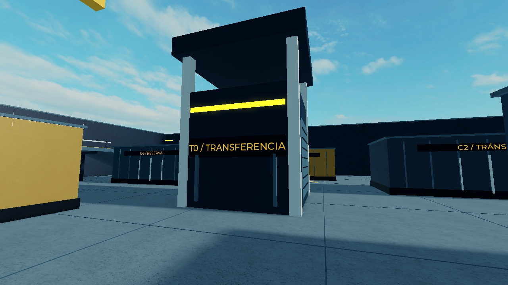
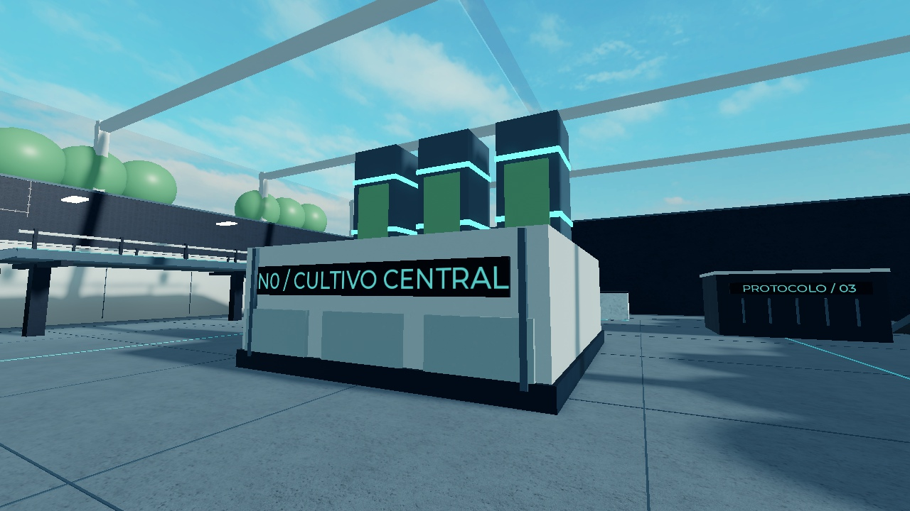

# Umbral 4

**Lee el código rival. Escríbelo antes de que te encuentren.**

Umbral 4 es un juego competitivo de Roblox para PC. Entre dos y ocho jugadores buscan rivales entre rampas, pasarelas y coberturas. Cada vida tiene un código de cuatro dígitos. Consigues una baja al teclear el código de un rival mientras sigue a la vista.

[Descargar el lugar para Roblox Studio](https://github.com/Pochonski/umbral-4/releases/download/v0.1.0/Umbral4.rbxlx) · [Ver versiones](https://github.com/Pochonski/umbral-4/releases)



Esta rama añade **Puerto de Carga**, **Invernadero de Protocolo** y votación entre rondas, sobre el menú Terminal industrial y Estación de Relevo. Es una candidata en revisión; el enlace de descarga anterior sigue siendo **v0.1.0**. Para obtener los tres mapas, compila esta rama con Rojo. Consulta el [informe de mapas, pruebas y rendimiento](docs/mapas-y-votacion.md) y el [playtest de 15 minutos](docs/playtest-tres-mapas.md).

El [refinamiento del PR #4](docs/refinamiento-tres-mapas.md) mejora las miniaturas y corrige su carga tardía, con pruebas de transición bajo latencia y revisión de Spawn 03/09. La prueba con dos oponentes bajo latencia permanece pendiente por memoria.





## Jugar en Roblox Studio

1. Descarga **Umbral4.rbxlx** y ábrelo en [Roblox Studio](https://create.roblox.com/docs/studio/setup).
2. En el selector de pruebas, elige **Servidor y clientes**, selecciona **2 clientes** y comienza la prueba.
3. Pulsa **Jugar** en las dos ventanas cliente. La ronda comienza después de una cuenta regresiva de 10 segundos.
4. Busca una placa rival y escribe sus cuatro dígitos. El último envía el ataque automáticamente.

Puedes abrir **Cómo jugar** en una sesión de un solo cliente para practicar con el código `0917`.

| Control | Acción |
| --- | --- |
| WASD, ratón y Espacio | Moverte, mirar y saltar |
| Fila numérica o teclado numérico | Escribir un código de cuatro dígitos |
| Retroceso | Borrar el último dígito |
| Esc | Limpiar la entrada y abrir el menú de Roblox |
| M | Abrir Ajustes durante la ronda |

## Reglas de la arena

- **La posición importa.** Las placas miran hacia el frente de su dueño. Una pared, la distancia o un giro del rival pueden hacer que pierdas la oportunidad de atacar.
- **Cada vida de la ronda tiene un código distinto.** Tras una baja reapareces en seis segundos con un código nuevo. Durante los primeros 2,5 segundos no puedes atacar ni recibir ataques.
- **La meta depende del tamaño de la ronda.** Se juega a 10 bajas con 2–3 jugadores, 15 con 4–5 y 25 con 6–8. A los cuatro minutos gana quien vaya en cabeza, con victoria compartida si hay empate. Quien llegue en mitad de la partida entra en la ronda siguiente.
- **Elige el siguiente destino.** Después de los resultados tienes diez segundos para votar entre los otros dos mapas. Puedes cambiar tu voto. El servidor resuelve los empates y la abstención; salir de la cola retira tu voto. El servidor comienza en Estación de Relevo.

## Código y mapa

Necesitas **Roblox Studio** y **[Rojo 7.7.1](https://github.com/rojo-rbx/rojo/releases/tag/v7.7.1)** para compilar el lugar desde el código fuente. El archivo de la versión se abre directamente en Studio.

```powershell
git clone https://github.com/Pochonski/umbral-4.git
cd umbral-4
rojo build default.project.json -o Umbral4.rbxlx
```

| Ruta | Contenido |
| --- | --- |
| [`src/server`](src/server) | Rondas, apariciones, visibilidad y validación de ataques |
| [`src/shared`](src/shared) | Configuración, geometría de las placas y reglas |
| [`src/client`](src/client) | Cámara, teclado, menús, interfaz de combate y efectos |
| [`map`](map) | Arena y vestíbulo editables en Studio |
| [`tests`](tests) | Pruebas de reglas e integración multijugador |

El servidor envía cada placa solo a los jugadores con alcance, ángulo y línea de visión válidos. Cuando recibe un código, revisa esas condiciones de nuevo y aplica el límite de intentos. El cliente dibuja la placa, lee el teclado y presenta el resultado.

**Migración obligatoria de esta candidata:** compila y abre una vez el lugar completo. Actualizar solo scripts sobre una copia anterior no instala las plantillas ni las miniaturas de los nuevos mapas.

Después puedes iterar con `rojo serve sync.project.json`, que sincroniza únicamente scripts. Relevo se conserva en `map/EstacionDeRelevo.rbxmx`; los dos mapas nuevos están en archivos independientes de `map/`. Los generadores gratuitos `tools/build_maps.py` y `tools/build_previews.py` permiten reproducirlos. Consulta el [procedimiento para editar y versionar mapas](docs/mapas-y-votacion.md#edición-y-mantenimiento).

## Pruebas

Con [Luau CLI 0.747](https://github.com/luau-lang/luau/releases/tag/0.747) y Rojo disponibles:

```powershell
luau tests/rules.luau
luau tests/input_buffer.luau
luau tests/map_vote.luau
python tests/verify_new_maps.py
python tests/verify_preview_assets.py
python tests/build_studio_qa.py (Get-Command rojo).Source Umbral4-QA.rbxlx
python tests/build_studio_qa.py (Get-Command rojo).Source Umbral4-Mapas-QA.rbxlx --maps
```

Abre el lugar QA con **Servidor y clientes** y **2 clientes**. Busca `[UMBRAL QA COMPLETE] PASS` en la salida del servidor. La copia QA acelera las rondas y contiene el canal de pruebas. El lugar descargable usa los tiempos de juego normales.

La copia `--maps` es otra prueba: busca **`[MAP QA COMPLETE] true`** en su servidor. Recorre tres rondas, combate, reapariciones, votación y una desconexión. Los guiones QA nunca se incluyen en la compilación de producción. GitHub Actions comprueba reglas, compilación, activos y reproducibilidad.

Consulta la [guía de validación de v0.2.0](docs/pruebas-v0.2.0.md) para ejecutar la matriz automatizada y repetir las pruebas con personas.
El [informe de cierre técnico](docs/cierre-v0.2.0.md) recoge la evidencia y los casos pendientes.

### Actualizar una copia de v0.1.0

Compila el lugar con el manifiesto completo para obtener el mapa actualizado junto con los scripts. Si trabajas sobre un mapa editado, replica el marcador `PlayableBounds` dentro del modelo de la arena. Debe estar anclado, sin colisión ni consulta, y contener todos los puntos de aparición. Su posición, tamaño y orientación definen el volumen jugable.

## Estado

**Candidata de tres mapas · PC.** La integración automatizada con dos clientes y las reglas de votación tienen evidencia en el [informe](docs/mapas-y-votacion.md). Las pruebas con dos personas en computadoras distintas, ocho clientes y hardware modesto siguen pendientes. La puntuación y los ajustes duran la sesión. Esta rama no publica ni fusiona ninguna versión.
