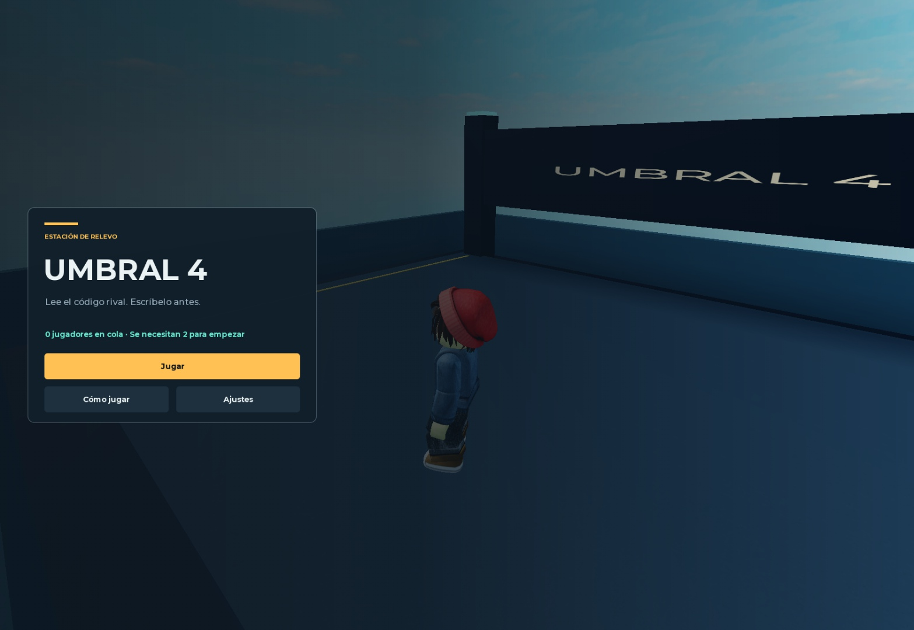

# Umbral 4

**Lee el código rival. Escríbelo antes de que te encuentren.**

Umbral 4 es un juego competitivo de Roblox para PC. Entre dos y ocho jugadores recorren **Estación de Relevo**, una arena industrial con rampas, pasarelas y coberturas. Cada vida tiene un código de cuatro dígitos. Consigues una baja al teclear el código de un rival mientras sigue a la vista.

[Descargar el lugar para Roblox Studio](https://github.com/Pochonski/umbral-4/releases/download/v0.1.0/Umbral4.rbxlx) · [Ver versiones](https://github.com/Pochonski/umbral-4/releases)



## Jugar en Roblox Studio

1. Descarga **Umbral4.rbxlx** y ábrelo en [Roblox Studio](https://create.roblox.com/docs/studio/setup).
2. En el selector de pruebas, elige **Servidor y clientes**, selecciona **2 clientes** y comienza la prueba.
3. Pulsa **Jugar** en las dos ventanas cliente. La ronda comienza después de una cuenta regresiva de 10 segundos.
4. Busca una placa rival y escribe sus cuatro dígitos. El último envía el ataque automáticamente.

Puedes abrir **Cómo jugar** en una sesión de un solo cliente para practicar con el código `0917`.

| Control | Acción |
| --- | --- |
| WASD, ratón y Espacio | Moverte, mirar y saltar |
| Fila numérica o teclado numérico | Escribir un código de cuatro dígitos |
| Retroceso | Borrar el último dígito |
| Esc | Limpiar la entrada y abrir el menú de Roblox |
| M | Abrir Ajustes durante la ronda |

## Reglas de la arena

- **La posición importa.** Las placas miran hacia el frente de su dueño. Una pared, la distancia o un giro del rival pueden hacer que pierdas la oportunidad de atacar.
- **Cada vida de la ronda tiene un código distinto.** Tras una baja reapareces en seis segundos con un código nuevo. Durante los primeros 2,5 segundos no puedes atacar ni recibir ataques.
- **La meta depende del tamaño de la ronda.** Se juega a 10 bajas con 2–3 jugadores, 15 con 4–5 y 25 con 6–8. A los cuatro minutos gana quien vaya en cabeza, con victoria compartida si hay empate. Quien llegue en mitad de la partida entra en la ronda siguiente.

## Código y mapa

Necesitas **Roblox Studio** y **[Rojo 7.7.1](https://github.com/rojo-rbx/rojo/releases/tag/v7.7.1)** para compilar el lugar desde el código fuente. El archivo de la versión se abre directamente en Studio.

```powershell
git clone https://github.com/Pochonski/umbral-4.git
cd umbral-4
rojo build default.project.json -o Umbral4.rbxlx
```

| Ruta | Contenido |
| --- | --- |
| [`src/server`](src/server) | Rondas, apariciones, visibilidad y validación de ataques |
| [`src/shared`](src/shared) | Configuración, geometría de las placas y reglas |
| [`src/client`](src/client) | Cámara, teclado, menús, interfaz de combate y efectos |
| [`map`](map) | Arena y vestíbulo editables en Studio |
| [`tests`](tests) | Pruebas de reglas e integración multijugador |

El servidor envía cada placa solo a los jugadores con alcance, ángulo y línea de visión válidos. Cuando recibe un código, revisa esas condiciones de nuevo y aplica el límite de intentos. El cliente dibuja la placa, lee el teclado y presenta el resultado.

Para iterar sobre una copia del lugar con el mapa ya cargado, ejecuta `rojo serve sync.project.json` y conéctate desde el plugin de Rojo en Studio. Ese manifiesto sincroniza las carpetas de scripts del juego. Para versionar cambios al escenario, exporta `Workspace.UmbralWorld` como `map/EstacionDeRelevo.rbxmx`.

## Pruebas

Con [Luau CLI 0.747](https://github.com/luau-lang/luau/releases/tag/0.747) y Rojo disponibles:

```powershell
luau tests/rules.luau
python tests/build_studio_qa.py (Get-Command rojo).Source Umbral4-QA.rbxlx
```

Abre el lugar QA con **Servidor y clientes** y **2 clientes**. Busca `[UMBRAL QA COMPLETE] PASS` en la salida del servidor. La copia QA acelera las rondas y contiene el canal de pruebas. El lugar descargable usa los tiempos de juego normales.

## Estado

**v0.1.0 · Prototipo jugable para PC.** Pasaron siete pruebas de reglas y una integración con dos clientes de Studio. Se verificaron la cobertura, el rechazo de ataques duplicados, la reaparición con código nuevo y el reinicio del marcador. Quedan pendientes las pruebas con cuatro y ocho clientes, el ajuste de la arena con jugadores reales y las mediciones de latencia y rendimiento. La puntuación y los ajustes duran la sesión.
