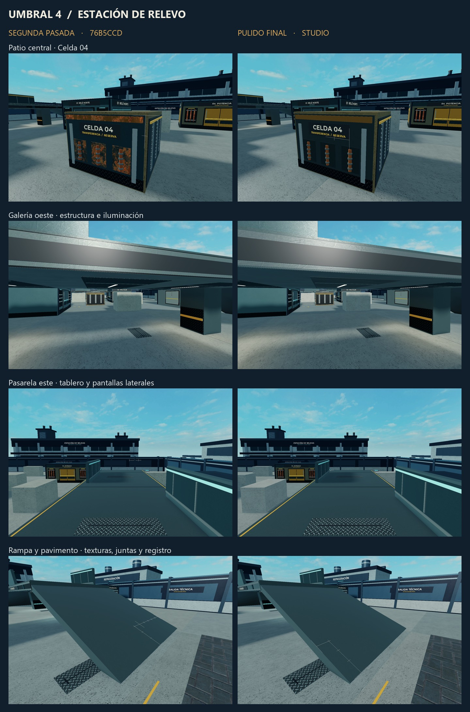

# Estación de Relevo · Pulido final y validación

Informe para ChatGPT. La referencia es el commit [76b5ccd](https://github.com/Pochonski/umbral-4/commit/76b5ccd151be15ebb09ac1c391daeb233390a37b), la segunda pasada artística del [PR #2](https://github.com/Pochonski/umbral-4/pull/2).



## Acabado visual

- **Celda 04.** Los aisladores conservan el cobre y la banda alta pasa a un latón apagado. Las tres placas traseras pasan a acero pintado oscuro. Esto concentra el color en los elementos eléctricos y deja un fondo más limpio para el rótulo.
- **Galerías.** Los cantos de vigas tienen acabado pintado con menor reflejo, los paneles centrales del techo pasan a metal liso y los extremos conservan la chapa lagrimada. Se moderó la intensidad de las luminarias y se añadió un poco de relleno difuso a la escena.
- **Hormigón.** Coberturas, zócalos y paños del suelo usan variaciones discretas de gris y cálido para que se distingan sus superficies desde primera persona. Las capturas de Celda, galería, pasarela y pavimento usan la misma posición y objetivo en ambos lugares.

El inventario sigue en 881 piezas. La comparación con el commit de referencia verificó las 123 piezas físicas o consultables originales, las 389 geometrías de relieve y los 14 marcadores. Se conservan sus dimensiones, transformaciones y propiedades de consulta, contacto y colisión. Los módulos Luau de juego coinciden con la base de estabilización del PR #1.

## Ataques contra avatares

Se ejecutaron dos clientes de Studio y un servidor local. El ensayo colocó a ambos avatares en puntos equivalentes alrededor de piezas del mapa y consultó si el `SurfaceGui` original de la placa estaba activo. El servidor de producción resolvió los ataques. Tres comprobaciones buscaron un borde que quedaba libre con la consulta de las piezas sólidas originales y que el relieve visible sí tapaba. La galería verificó un soporte físico existente.

| Zona | Elemento que bloqueó el rayo | Tras cobertura | Tras volver a abrir el ángulo |
| --- | --- | --- | --- |
| Celda 04 | Travesaño de latón | La placa se retiró y el código recordado dio `miss` | Placa activa y `hit` |
| Potencia | Conductor de cobre | Placa retirada y `miss` | Placa activa y `hit` |
| Refrigeración | Aspa | Placa retirada y `miss` | Placa activa y `hit` |
| Galería oeste | Soporte original | Placa retirada y `miss` | Placa activa y `hit` por VirtualInput |

No hubo rechazos inesperados con placa estable en esos cuatro casos. Las pruebas usaron avatares colocados por el banco de pruebas. La lectura corriendo y el envío durante la transición exacta de cobertura se conservan como pruebas humanas pendientes.

La auditoría geométrica final confirmó 0 discrepancias en 8.891 rayos y el respaldo de los 389 relieves dentro de un máximo de 0,251 studs. Las ocho rutas de navegación y los doce puntos de aparición conservaron el resultado de la segunda pasada. [Datos del banco de pruebas](evidence/relevo-pulido-final.json)

## Rendimiento

### Coste durante una ronda con dos clientes

La medición de la segunda pasada pasó de 2,17 a 4,36 µs por consulta espacial en Edit. Para comprobar el efecto en una ronda se usó la compilación final y se fijó el recorrido de dos avatares. El atacante consiguió dos bajas por ronda. La secuencia de perfiles desactiva, activa, activa y desactiva la consulta de los 389 relieves únicamente en la sesión de prueba. Así conserva el mismo lugar, cámara, luces y servidor de combate. Las cifras vienen de `Umbral.VisibilityServer`, el contador de producción que registra la actualización de visibilidad. Incluyen selección de candidatos, rayos y actualización de concesiones. Las pruebas de borde se hicieron con los relieves activos.

| Ronda | Relieves consultables | Actualizaciones | Rayos | Media por actualización, ms | Pico, ms |
| --- | --- | ---: | ---: | ---: | ---: |
| 1 | Desactivados en QA | 282 | 680 | 0,038 | 0,096 |
| 2 | Activos | 285 | 684 | 0,042 | 0,111 |
| 3 | Activos | 282 | 672 | 0,043 | 0,206 |
| 4 | Desactivados en QA | 283 | 680 | 0,039 | 0,222 |

El coste medio observado con los relieves activos es aceptable para dos clientes y este recorrido. El incremento del ensayo aislado de un rayo se refleja en unas milésimas de milisegundo por actualización completa. Los picos de esta muestra quedaron por debajo de 0,23 ms. La medición aún no cubre el volumen de líneas de visión con ocho jugadores ni otro procesador. Los 389 relieves quedaron activos en la compilación entregada y el perfil normal de Studio se restauró.

### Render a 720p y 1080p

Un cliente de Studio en primer plano en el mismo equipo (Ryzen 5 5600G, RTX 5060). Se usaron las configuraciones de escritorio HD 720 y HD 1080 del simulador con escala real y calidad gráfica `Level10`. El ensayo verificó que `Camera.ViewportSize` y el perfil del simulador coincidían con la resolución pedida. Cada celda compara el p95 de 150 cuadros tras calentar la escena. Son escenas con cámaras equivalentes de un solo cliente. La carga del servidor multijugador se midió en la prueba anterior. [Contadores de Studio](https://create.roblox.com/docs/reference/engine/classes/Stats) · [Modos de prueba](https://create.roblox.com/docs/studio/testing-modes)

| Vista | 1280 × 720, p95 de cuadro en ms | 1920 × 1080, p95 de cuadro en ms |
| --- | ---: | ---: |
| Patio | 18,15 → 17,65 | 18,26 → 17,97 |
| Galería | 17,84 → 18,01 | 18,06 → 18,06 |
| Pasarela | 18,07 → 17,81 | 17,57 → 17,76 |

La mediana se mantuvo cerca de 16,7 ms. Las variaciones de p95 entre cámaras son pequeñas para inferir cambios de FPS. El simulador volvió a la configuración normal al terminar.

## Spawn 03 y playtest

La baliza contigua sigue dentro de la caja de holgura del marcador. En la compilación final, un avatar controlado por `Humanoid:MoveTo` recorrió 4,19 studs hacia +X y 4,21 hacia +Z en una solicitud de 5 studs. En la prueba diagonal hacia la baliza recorrió 4,46 studs. La prueba automatizada no reprodujo un bloqueo de salida y se conservó la ubicación de la baliza. Falta comprobar el primer paso con teclado y ratón.

La [guía privada de playtest](playtest-local-estacion-de-relevo.md) permite abrir la compilación local, lanzar dos clientes y repetir teclado, ratón, sombra y sol, cambios de cobertura y reaparición. En un escritorio, las personas pueden alternar el control. La partida humana simultánea queda pendiente de un entorno privado compartido. Esta entrega usa un archivo local y el PR de código sigue en borrador.

## Reproducción

```pwsh
rojo build default.project.json -o Umbral4-Estacion-de-Relevo-Pulido-Final.rbxlx
rojo build default.project.json -o Umbral4-rebuild.rbxlx
rojo sourcemap sync.project.json -o sourcemap.json
python -B tests/verify_arena_art.py 76b5ccd
python tests/verify_place.py Umbral4-Estacion-de-Relevo-Pulido-Final.rbxlx Umbral4-rebuild.rbxlx sourcemap.json
```

En una copia de QA en Studio, copia `tests/relevo_final/StudioServer.server.luau` a un Script en ServerScriptService y `tests/relevo_final/StudioClient.client.luau` a un LocalScript en StarterPlayerScripts, ambos con nombre `RelevoFinalQA`. En el Config de esa copia usa `Countdown = 3`, `ResultsDuration = 1.2`, `RespawnDelay = 1.4` y `RoundDuration = 95` para bordes o `31` para el benchmark. Ejecuta en el modelo Edit de esa copia:

```lua
local profile = false -- true para medir las cuatro rondas de visibilidad
task.spawn(function()
    print(game:GetService("StudioTestService"):ExecuteMultiplayerTestAsync(2, {profile = profile}))
end)
```

Conserva del Output las líneas `[RELEVO EDGE]`, `[UMBRAL PERF]`, `[RELEVO PROFILE]` y `[RELEVO FINAL QA]`. Ejecuta `tests/relevo_final/measure_resolution_in_studio.luau` en el cliente de Play y repite con `requestedDevice = "hd_1080"`. Usa `tests/check_spawn_03_in_studio.luau` en un cliente aislado y `tests/audit_relevo_occlusion.luau` en Edit para repetir las comprobaciones geométricas.

Rojo produjo dos compilaciones idénticas con ocho scripts de producción, doce marcadores y el modelo separado de la sincronización de scripts. Los once casos de reglas y entrada pasaron. SHA-256 del lugar entregado `cfa4578991a981d3d4aded736cd2b14f6e7ac15eb4695c4b7b72786833f69b43`.

## Recomendación

El PR #2 puede aprobarse técnicamente dentro del alcance del mapa. La compilación está lista para el playtest privado y el PR permanece en borrador por instrucción. Para la aceptación de la experiencia quedan la lectura en movimiento, los cruces de cobertura y la salida física de Spawn 03 con personas. Conviene registrar también una ronda llena para extender la medición de rendimiento a ocho participantes.
