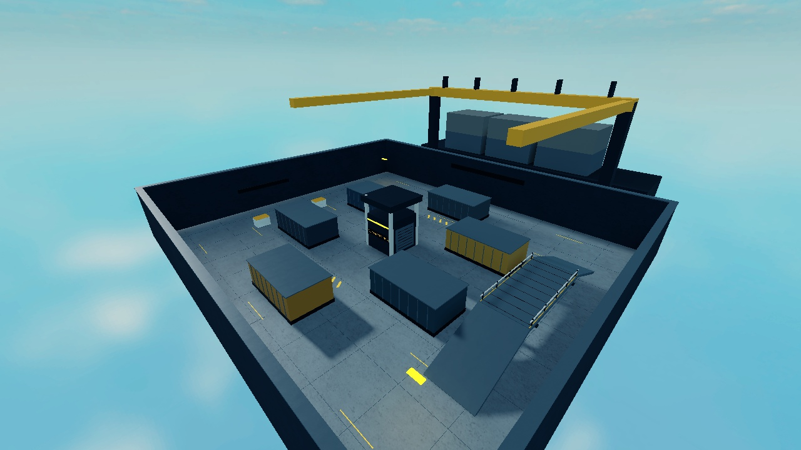
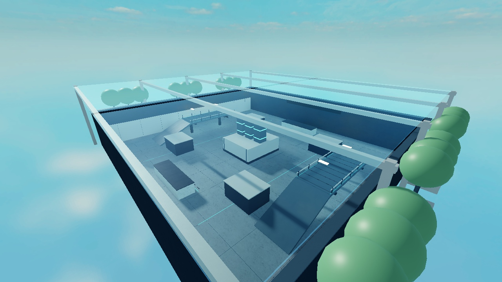
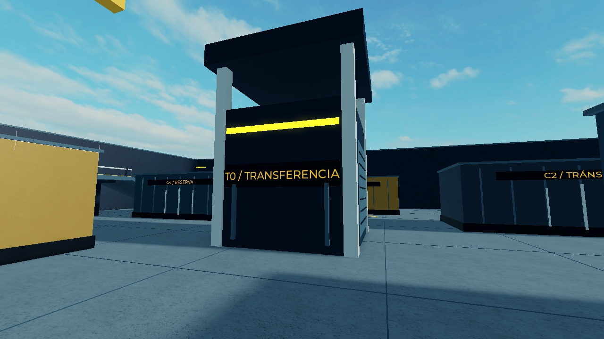
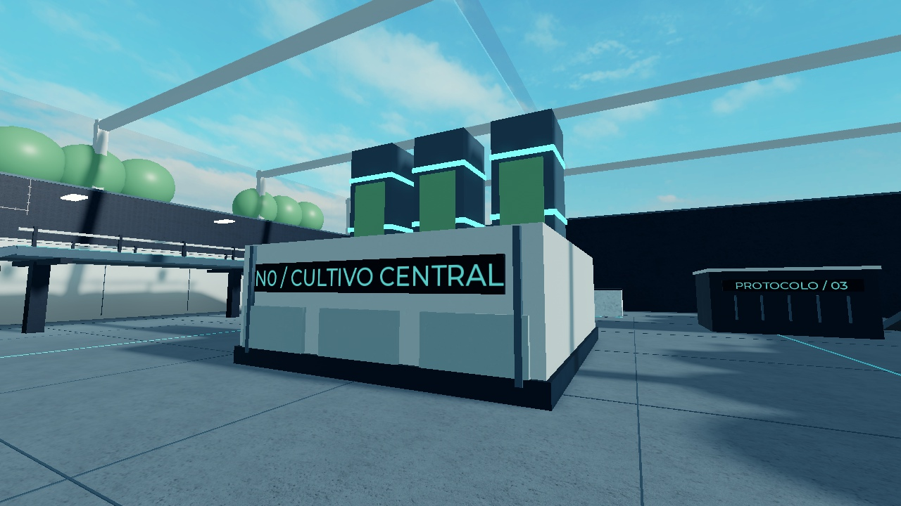
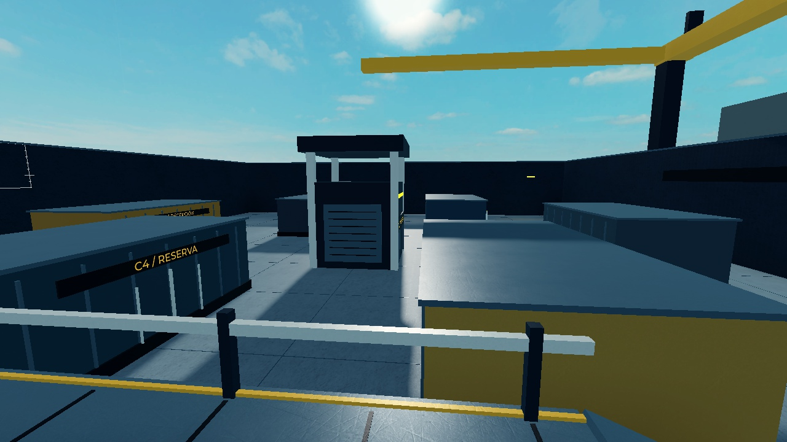
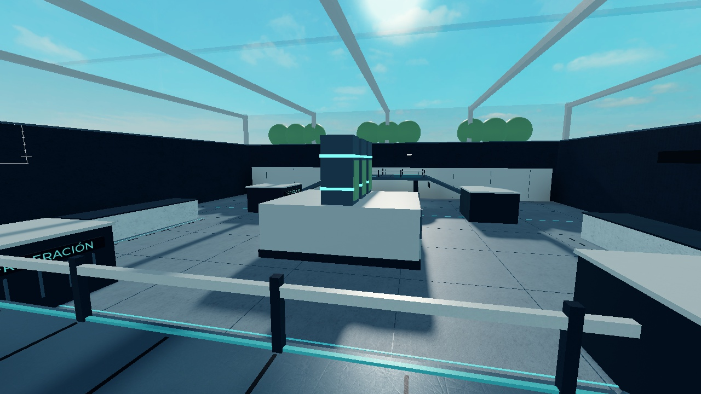
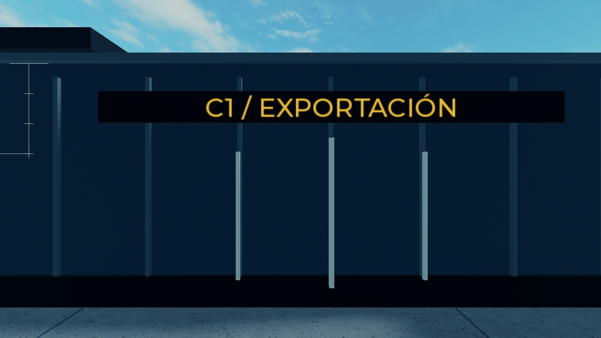
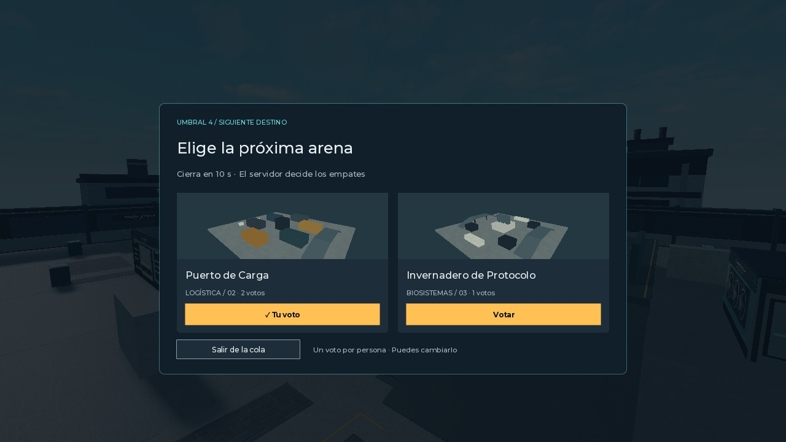

# Umbral 4 — Dos mapas y votación entre rondas

Informe técnico dirigido a ChatGPT y al propietario. Fecha: 18 de noviembre de 2026.

## Resumen ejecutivo

La candidata añade **Puerto de Carga** e **Invernadero de Protocolo**, con elección del próximo mapa por votación al terminar cada ronda. Parte de `0da999338c24ca562ff402cb1e0cc25ac487a30e`, rama `ui/terminal-principal`. Se trabaja en `maps/puerto-invernadero`, en un worktree separado. No modifica las ramas de estabilización ni arte y no fusiona sus PR. No publica en Roblox.

Entrega: [PR #4 en borrador](https://github.com/Pochonski/umbral-4/pull/4), apilado sobre #3. [Commit de implementación y evidencias](https://github.com/Pochonski/umbral-4/commit/897af348afa68830c2ca2280b53b9db40537ee48). [GitHub Actions: validación satisfactoria de ese commit](https://github.com/Pochonski/umbral-4/actions/runs/44252074715). El historial posterior puede incorporar documentación; el paquete identifica su commit exacto en `REVISION.json`.

Estación de Relevo conserva su archivo original, sus coberturas, Bounds y puntos de aparición. La autoridad del combate, los límites de alcance y ángulo, la escritura y los tiempos de protección permanecen como en la base. La nueva integración cambia la referencia del mapa activo y añade el estado de votación.

Los resultados documentados son de automatización y observación real de Studio. **No se ha realizado un playtest con dos personas**, ni una certificación con ocho clientes o hardware modesto. El objetivo de esta entrega es una candidata reproducible para revisar y jugar, no una declaración de equilibrio competitivo definitivo.

## Dirección de los mapas

| Mapa | Composición y lectura | Geometría nativa | Apariciones | Luces locales |
| --- | --- | ---: | ---: | ---: |
| Puerto de Carga | Torre T0, seis contenedores identificados, muelle elevado al este y barreras bajas al oeste. Acero, hormigón y ámbar; grúa exterior como silueta | 278 piezas | 12 | 2 |
| Invernadero de Protocolo | Núcleo de cultivo N0, refrigeración, bancos técnicos y galerías laterales conectadas por rampas. Paneles claros, acero, cian y verde moderado; cubierta acristalada | 264 piezas | 12 | 4 |

Los recuentos incluyen suelo, perímetro, marcadores invisibles y fondo. Las luces añadidas no proyectan sombras locales. Se usa la iluminación de tarde de la base, sin añadir efectos de posprocesado por mapa. Materiales nativos y geometría propia; no se instalaron dependencias ni se incorporaron recursos de pago o de terceros.

Puerto tiene una losa de 128 × 112 studs; Invernadero, 112 × 104. Ambos tienen dos alturas transitables y más de una entrada a sus galerías. El perímetro de 18 studs busca impedir salidas por salto ordinario; su resistencia al movimiento humano y a maniobras no previstas necesita playtest. `PlayableBounds` se genera a partir de las dimensiones de cada arena y contiene sus marcadores.

Los elementos opacos de cobertura y sus relieves son consultables. Juntas y pintura a ras del suelo no son obstáculos ni coberturas. Los elementos de fondo no consultables están fuera del volumen de combate o sobre él. La prueba geométrica compara las decisiones de combate frente a una copia de toda la geometría opaca con consulta activada, incluyendo posiciones apoyadas en suelo y superficies elevadas. Es muestreo, no una demostración para cada posible posición.

### Capturas reales

Capturas de Studio del modelo editable, a 1280 × 720, calidad 10. Las cámaras de presentación se colocaron explícitamente; las imágenes desde altura de ojos representan la geometría visible y no son una prueba de controles humanos ni de combate. No se usaron imágenes generadas por IA.

| Puerto | Invernadero |
| --- | --- |
|  |  |
|  |  |
|  |  |



La comparación aquí es entre dos escenarios nuevos, no un antes/después de Relevo. Su fuente permanece intacta.

## Votación y carga

1. El servidor comienza en Relevo con el flujo normal de espera y cuenta regresiva.
2. Después de los resultados de una ronda, mueve los personajes al vestíbulo e inicia **diez segundos de votación**.
3. Ofrece los otros dos mapas. Cada usuario preparado tiene un voto que puede cambiar. Salir de cola o desconectarse lo elimina; entrar durante la votación permite participar.
4. El servidor elige la mayoría. En empate o abstención usa su propio `Random` entre las opciones empatadas.
5. Antes de retirar la arena anterior prepara y valida un clon de la siguiente. Instala exactamente un mapa en `Workspace.UmbralWorld.ActiveArena`; después vuelve a la espera y a la cuenta regresiva habitual si hay suficientes jugadores.
6. Si una plantilla nueva es inválida, intenta recuperar Relevo. Si también falla la recuperación, no comienza combate: permanece fuera de partida y reintenta. Un despliegue sin la carpeta de plantillas falla al arrancar con un mensaje que exige reconstruir el lugar completo.

Las plantillas inactivas viven en `ServerStorage`. El vestíbulo permanece en Workspace. El fondo original `Complejo exterior` se incorpora **solo al clon runtime de Relevo**; no acompaña a los nuevos mapas y no se altera su archivo fuente.

El contenedor activo es estable para las referencias de raycast de cliente y servidor. `mapRevision`, ronda y vida invalidan entrada y placas anteriores. El cliente no presenta placas hasta que la revisión del contenedor coincide con la instantánea de estado y hay un solo modelo activo. Esto reduce desajustes de transición; la replicación lenta en internet aún necesita pruebas reales.

### Interfaz

Dos tarjetas con nombre, sector, votos y selección; botón para salir de la cola. Las miniaturas son `ViewportFrame` estáticos con un máximo de 42 piezas de cada mapa real, sin scripts, luces ni animación continua. Se prefirió esta representación reproducible a subir imágenes como activos de Roblox. Hay tres modelos pequeños en ReplicatedStorage y únicamente dos vistas activas en la votación.



[Captura a 1080p](images/mapas-votacion-1080.jpg). Estas dos capturas muestran la interfaz real renderizada con una **papeleta sintética de QA** para estabilizar el encuadre. Los votos por red se prueban por separado. `mapas-votacion-real.jpg` conserva una captura anterior durante una ronda QA real; sus miniaturas son de una iteración previa.

En ambas resoluciones se verificaron límites, 11 textos sin recorte y activación de los tres botones con VirtualInput. La regresión del menú existente cubrió cuatro resoluciones, práctica, ajustes, Retroceso, entrada y salida de cola. No se atribuyen estos resultados a teclados físicos.

## Arquitectura y seguridad

| Archivo | Responsabilidad |
| --- | --- |
| `src/shared/Maps.luau` | Catálogo de identificadores, nombres, modelos y cámaras |
| `src/shared/MapVote.luau` | Reglas puras de papeleta, votos, conteo y elección |
| `src/server/Arena.luau` | Preparación, validación, recuperación y sustitución de la arena |
| `src/server/Main.server.luau` | Pertenencia a la cola, plazo, rate limit, elección y transiciones |
| `src/client/MapSelection.luau` | Tarjetas, miniaturas y presentación de votos |
| `tools/build_maps.py` / `build_previews.py` | Activos nativos deterministas |

El mensaje nuevo es `Request("vote", ballotId, mapId)`. El servidor verifica fase, plazo, usuario preparado, identificador de papeleta, opción válida y un bucket separado de dos solicitudes por segundo con ráfaga de dos. El emisor no puede acumular varios votos. Se mantienen los canales y validaciones existentes de ataques; no se aceptan posiciones ni visibilidad declaradas por el cliente.

Los controles de plantillas comprueban modelo, Bounds, cantidad y posición de marcadores, geometría anclada y ausencia de scripts. Los controles estructurales adicionales de CI limitan las clases nativas, piezas y luces de los dos nuevos activos. Esto no convierte recursos desconocidos en seguros automáticamente; aquí todos los recursos se generan en el repositorio.

## Validación y defectos encontrados

### Resultados de Studio

Evidencias bajo `docs/evidence/`:

| Evidencia | Alcance comprobado |
| --- | --- |
| `mapas-two-clients.json` | Dos procesos cliente reales de Studio, servidor local, tres rondas consecutivas, 13 comprobaciones de integración. No personas |
| `mapas-single-client.json` | Un cliente con mínimos/tiempos de QA, botones reales pulsados por VirtualInput, cuatro rondas, votos y recuperación a Relevo tras retirar Bounds de Puerto solo en memoria QA |
| `mapas-menu-regression.json` | Menú existente en 1280×720, 1920×1080, 1280×800 y 1024×768; práctica y ajustes |
| `mapas-vote-layout-720.json` / `1080.json` | Layout sintético, texto y botones de votación a resolución nativa |
| `mapas-performance.json` | Comparación final de renderizado, navegación y oclusión; método y cifras debajo |
| `mapas-fallback-final.json` | Recuperación final con Bounds de Puerto retirado solo en QA; fondo original dentro del clon de Relevo y ausente como fondo compartido |
| `mapas-build-validation.json` | Compilación de 34 archivos Luau, análisis de módulos puros, 17 pruebas de reglas/entrada/votación, activos deterministas y dos builds idénticos |

La integración de dos clientes comprueba: un mapa activo, doce apariciones apoyadas, envolventes de avatar despejadas en los mapas nuevos; divulgación frontal de código; rechazo de un código recordado tras cobertura; baja y aumento de puntuación; reaparición con **nueva vida**; rechazo de un ataque de la ronda anterior tras cambiar de mapa; opciones/votaciones antiguas o falsas; salida y vuelta a la cola; retirada de voto por una desconexión real controlada. En ambos mapas nuevos se ensayaron objetivos reales a ambos lados de una cobertura opaca nativa y una esquina abierta, además de una pared sintética.

La navegación automática busca rutas desde los marcadores hacia el primero en orden de nombre. El campo histórico `pathsToSpawn01` del JSON se refiere a ese primer marcador: `Spawn 00` en Relevo y `Spawn 01` en los mapas nuevos. El caso de origen igual a destino se considera trivial; los otros once se consultan a Pathfinder.

La prueba envía ataques por RemoteEvents desde clientes QA y coloca personajes de forma controlada. **No demuestra escritura física, comodidad al correr ni justicia de todas las esquinas.** No se añadió una prueba de latencia de internet a esta etapa ni se repitió toda la matriz adversa de v0.2.0.

### Correcciones sustentadas por observación

- Las primeras posiciones de Spawn 02 y 11 del Invernadero invadían un banco técnico: una consulta de volumen de avatar lo reprodujo. Se desplazaron hacia el perímetro antes de finalizar los activos. Los dos mapas nuevos terminaron con 12 posiciones despejadas y apoyadas.
- Se separaron marcadores laterales de las rampas para evitar aparecer dentro de una pendiente.
- El fondo compartido de Relevo aparecía detrás de mapas nuevos. Se corrigió su pertenencia runtime; su modelo fuente sigue idéntico.
- La primera prueba de reaparición aceptaba el estado `alive` previo y la prueba de colocación podía ejecutarse antes de terminar `LoadCharacterAsync`. Se corrigieron **los fixtures de QA**: esperar estado vivo, anclar antes de colocar y exigir cambio de `lifeId`. Estos fallos no se reportan como defectos del combate.
- La ruta de un punto hacia sí mismo puede devolver `NoPath`; la prueba de navegación ahora considera ese caso trivial antes de usar Pathfinder para los otros once destinos. El JSON inicial de un cliente conserva ese resultado anterior, sin reinterpretarlo como bloqueo físico.
- El primer control de layout olvidaba transformar las coordenadas de GUI por el inset de Roblox; se corrigió el test, sin desplazar la interfaz del juego.

### Conservación de Relevo

`verify_new_maps.py` compara su SHA-256 normalizado con el de la base aprobada. No se modifican piezas físicas, Spawn 03 ni Bounds de Relevo. La inspección de envolvente de avatar detecta intersección conservadora en Spawn 03 y 09 de ese mapa existente; esto **no prueba que el jugador quede atrapado**. Se conserva como verificación humana pendiente. No se reclama haber salido con controles físicos de Spawn 03.

## Rendimiento y oclusión

La tabla final reproducible se incorpora en [mediciones de esta candidata](mapas-mediciones.md). Los datos crudos son `mapas-performance.json`. La primera tanda `mapas-performance-initial.json` se conserva como diagnóstico, pero **no es la comparación final**: no fijaba suficientemente la cámara y el estado de la interfaz durante el arranque.

La medición final usa un solo cliente local con servidor de Studio, Config de producción y una copia QA que expone carga/inspección. Una sola cámara fija, FOV 70, UI del juego y CoreGui ocultas, cinco segundos de calentamiento y dos muestras de quince segundos por combinación. Son tres mapas × dos calidades (5 y 10) × dos resoluciones nativas (720p y 1080p) × dos repeticiones: 24 muestras. Se afirman resolución, cámara y UI al terminar cada muestra.

Resultado observado: medianas de cuadro entre **16,625 y 16,701 ms**, p95 entre **17,601 y 18,223 ms**. La auditoría final comparó 9.388 pares dirigidos mediante **32.212 raycasts**, con cero discrepancias; no aparecieron marcadores sin suelo ni rutas automáticas fallidas en los tres mapas. Las envolventes de los nuevos mapas quedaron libres; las observaciones conservadoras de Relevo siguen pendientes de evaluación humana.

Equipo: Ryzen 5 5600G, RTX 5060, aproximadamente 16 GB de RAM. Esto **no es hardware modesto**. Se capturan PreRender, RenderCPUFrameTime, RenderGPUFrameTime, memoria del cliente y composición de escena. El tiempo total incluye la cadencia del motor; una mediana próxima a 16,7 ms no demuestra margen de GPU ni una mejora de FPS. Es renderizado en reposo, no combate de ocho jugadores. No se tomó una sesión de MicroProfiler para esta comparación.

La prueba de dos clientes se intentó con poca memoria libre, se detuvo para no forzar el equipo y se completó después de cerrar normalmente el navegador que el propietario autorizó cerrar. En la ejecución final se observaron alrededor de 1,7 GB libres. No se inició una prueba de ocho clientes.

## Reproducción de pruebas

Luau CLI 0.747 y Rojo 7.7.1, las mismas versiones fijadas por CI:

```powershell
luau tests/rules.luau
luau tests/input_buffer.luau
luau tests/map_vote.luau
luau-analyze src/client/InputBuffer.luau src/shared/Config.luau src/shared/Rules.luau src/shared/MapVote.luau
python tests/verify_new_maps.py
python tools/build_maps.py
python tools/build_previews.py
git diff --exit-code -- map
rojo build default.project.json -o Umbral4.rbxlx
rojo build default.project.json -o Umbral4-rebuild.rbxlx
rojo sourcemap sync.project.json -o sync.json
python tests/verify_place.py Umbral4.rbxlx Umbral4-rebuild.rbxlx sync.json
python tests/build_studio_qa.py (Get-Command rojo).Source Umbral4-Mapas-QA.rbxlx --maps
```

Abrir únicamente la copia `--maps` para QA y ejecutar Servidor y clientes con 2 clientes. Observar `[MAP QA PASS]` y finalmente **`[MAP QA COMPLETE] true`** en el servidor. La desconexión del segundo cliente al final es deliberada. La compilación normal no contiene el harness, remotos QA ni temporizadores acelerados.

Para repetir el ciclo de un cliente: en una **copia desechable**, añadir `tests/maps/SingleServer.server.luau` como Script de servidor, cambiar solo allí MinPlayers=1, Countdown=1, RoundDuration=24, ResultsDuration=1 y VoteDuration=8; ejecutar Play y `single_client_cycle.luau` mediante MCP Client. Guardar `MapsSingleResult` antes de detener. Para medir, usar ese inspector con **Config de producción** y `profile_client.luau`; guardar `MapsProfileResult`. No ejecutar carga de CPU ajena durante las muestras. Detener la simulación de dispositivo después.

`vote_layout.luau` se ejecuta en Client con un jugador inactivo: llamar `_G.UmbralVoteLayoutResize(1280,720)` o `(1920,1080)`, capturar y finalmente `_G.UmbralVoteLayoutCleanup()`. Su papeleta sintética no simula votos por red.

## Edición y mantenimiento

1. Compilar **`default.project.json` completo** una vez para migrar. La nueva carpeta ServerStorage y las miniaturas no las instala `sync.project.json`. Abrir la copia nueva sin sustituir un trabajo de Studio sin guardar.
2. Para código posterior, servir `sync.project.json` como en la base. El manifiesto conserva su alcance de scripts y deja los mapas editables.
3. Relevo continúa en `map/EstacionDeRelevo.rbxmx`. Puerto e Invernadero están en sus archivos independientes. En Edit, sus plantillas están en ServerStorage: para inspeccionar una, clonar temporalmente a Workspace y retirar esa copia antes de guardar/exportar. No exportar `ActiveArena` de una sesión Play como si fuera la fuente.
4. Los dos mapas nuevos se generan con `tools/build_maps.py`. Preferir modificar ese generador y reconstruir para mantener el resultado determinista. Una edición manual exportada debe trasladarse al generador antes de pasar CI; no ejecutar el generador sobre cambios manuales sin conservarlos primero.
5. Mantener `PlayableBounds`, Folder `Spawns`, 12 marcadores, geometría anclada y ningún script en los modelos. Revisar colisión y consulta de cada superficie opaca.
6. Tras cambiar geometría, regenerar `MapPreviews.rbxmx`, repetir gates, compilación y las pruebas de navegación/oclusión. Los límites de CI son un techo de seguridad, no un objetivo para añadir piezas.

El lugar de producción se verifica contra el sourcemap de sincronización: doce scripts esperados y ninguna instancia `UmbralQA`. El paquete de revisión contiene código de pruebas como fuente, pero su lugar jugable no los incorpora.

La compilación local `Umbral4-TresMapas.rbxlx` tiene SHA-256 `19187bdc4f5627661ac24c2a3aedc8c26faf871c2213141019046226ec9e7649`. Dos compilaciones consecutivas del mismo checkout resultaron idénticas. Esta igualdad no se presenta como garantía binaria entre plataformas o configuraciones de finales de línea.

## Riesgos residuales y siguiente decisión

- Equilibrio de rutas, tiempos de encuentro, justicia de apariciones y legibilidad al moverse: pendiente de **dos personas**. La guía de [15 minutos](playtest-tres-mapas.md) incluye registro de errores de ambos jugadores.
- Ocho clientes y hardware modesto pendientes; no extrapolar el perfil de una RTX 5060.
- La auditoría geométrica es finita. No certifica cada píxel, cámara, esquina ni latencia.
- Mapas completos sin streaming simplifican esta escala. La transición por red real y el tiempo de replicación necesitan comprobación en una experiencia de prueba autorizada.
- Consolas/móvil, progresión y monetización siguen fuera de esta entrega.

**Recomendación: mantener el PR en borrador para revisión y playtest humano.** La candidata permite revisar dos mapas y su flujo real; no se recomienda publicarla ni fusionarla automáticamente. La siguiente etapa es jugar las tres arenas con dos personas, registrar rechazos y salidas de Spawn 03, y decidir ajustes a partir de casos reproducibles. No se propone otro rediseño de Relevo.
