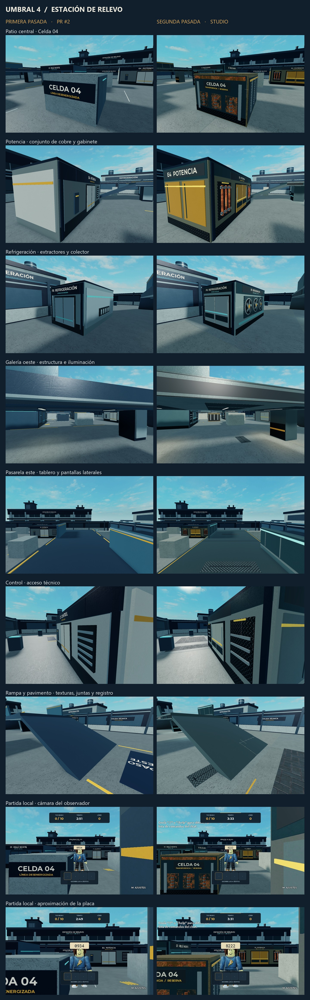

# Estación de Relevo · Segunda pasada artística

Informe para ChatGPT. La referencia de esta revisión es la primera pasada artística, commit [66bd7e8](https://github.com/Pochonski/umbral-4/commit/66bd7e8cc750dcf41ba6586470d26a89c71a3784) del [PR #2](https://github.com/Pochonski/umbral-4/pull/2).



## Dirección artística

La subestación se lee ahora desde el suelo. Celda 04 orienta en el patio con tres aisladores de color cobre, una carcasa más oscura y una banda de latón envejecido. Potencia se distingue por los gabinetes ámbar, los conductores verticales y las guías metálicas. Refrigeración se reconoce por tres extractores circulares, un colector cian y una fachada más clara. Los tres hitos revisten volúmenes que el jugador ya reconocía como coberturas.

- Las fachadas principales tienen puertas con hojas, marcos y refuerzos diferenciados. Las caras secundarias son más sencillas y conservan la función de cada sector.
- Las galerías incorporan cantos de vigas, protecciones de pilares, paneles de techo y luz cálida en el oeste y fría en el este. Se retiraron los conductos bajos de la primera pasada. En los tableros elevados se distinguen las juntas, los registros y las guías del borde.
- El hormigón del suelo combina paños de tono levemente distinto. Los accesos de servicio usan pavimento nativo y las tapas de registro usan chapa lagrimada. El desgaste se concentra en la celda y los conductores. El acero pintado se mantiene legible alrededor de los accesos.
- La luz pasa a las 16,08 con relleno adicional en sombras y cuatro luces de techo de alcance corto, con sombras desactivadas. El bloom baja de 0,08 a 0,055. Las capas de color, textura y sombra se revisaron en tomas equivalentes a la altura de los ojos y en el cliente de combate.

Se eligieron materiales nativos para que el lugar pueda reconstruirse y editarse localmente. `MaterialVariant` tendría sentido si la dirección exigiera controlar la escala, la rugosidad o los mapas por material. `SurfaceAppearance` se destina a mallas con UV y mapas PBR. La geometría de esta pasada usa piezas nativas, por lo que ninguno de esos enfoques exige actualmente una dependencia externa. Los materiales de las piezas físicas originales se conservaron respecto a la primera pasada. [Materiales de Roblox](https://create.roblox.com/docs/parts/materials) · [MaterialVariant](https://create.roblox.com/docs/reference/engine/classes/MaterialVariant) · [Texturas PBR](https://create.roblox.com/docs/art/modeling/surface-appearance)

## Auditoría de integridad competitiva

El ensayo en Studio duplica temporalmente la geometría opaca que podría ver la cámara, conserva su forma y la compara con el filtro de raycast que usa el servidor. Ejecuta 8.891 rayos reproducibles entre galerías, tangentes de fachadas y trayectorias con alturas de cabeza o placa. La etiqueta de superficie se conserva para reproducir los casos. La copia se elimina tras el ensayo.

| Comparación | Primera pasada | Segunda pasada |
| --- | ---: | ---: |
| La geometría visible bloquea y el raycast original deja pasar | 520 | 0 |
| El raycast bloquea y la geometría visible deja pasar | 0 | 0 |
| Piezas físicas o consultables originales verificadas en el modelo | 123 | 123 |
| Añadidos visibles consultables junto a coberturas existentes | 0 | 389 |
| Distancia máxima de un relieve consultable a su respaldo | — | 0,251 studs |

En la primera pasada, un ejemplo fue el conducto de galería oeste. El rayo de `(-39, 4,45, -11,50)` a `(-23, 4,465, -11,50)` atravesaba su volumen sin que el servidor detectara obstrucción. El conjunto de discrepancias incluye pruebas de estrés a ras de pared. Cada una representa una comparación geométrica, y su recuento no equivale a eliminaciones reproducidas en una partida.

Se retiraron las piezas colgantes y se redujo el perfil de los nuevos acabados. Los relieves opacos que sobresalen de puertas, pantallas o maquinaria se incluyeron en la consulta con su geometría visible real. Permanecen anclados, con `CanCollide=false` y `CanTouch=false`. La prueba comprueba que las ocho esquinas de cada relieve quedan dentro de la caja de una cobertura existente ampliada como máximo 0,30 studs por eje. Este límite evita que los acabados se conviertan en barreras consultables independientes. Los acabados transparentes que alojan texto, las marcas al ras del suelo y el complejo exterior siguen fuera del filtro. El código de producción de cliente, servidor y multijugador coincide con el de la primera pasada.

La revisión de rutas cubrió cuatro rampas, dos galerías y dos corredores. También comprobó suelo y límites para los doce marcadores y la misma regla de visibilidad para un rival frontal, de espaldas y tras cobertura.

### Spawn 03

En ambas versiones, el volumen de holgura del marcador abarca dos piezas de una baliza contigua. En Play se colocó el avatar en su posición original y se pidió a su `Humanoid` avanzar 5 studs. El recorrido por +X fue de 4,19 studs en ambas versiones y el recorrido por +Z pasó de 4,36 a 4,21 studs. La petición diagonal hacia la baliza alcanzó 4,30 y 4,27 studs respectivamente. Se conservó el marcador y queda pendiente valorar el primer paso con teclado y ratón reales.

## Rendimiento

En el mismo equipo (Ryzen 5 5600G, RTX 5060), con un cliente de Studio en primer plano, cuatro cámaras a FOV 70 y 150 cuadros por vista y configuración. Se verificó el valor de calidad `Automatic` o `Level03` en `RenderSettings` y se restauró el valor previo. La resolución comparable de las cuatro vistas fue de **405 × 635**. Las cifras corresponden a este viewport y a una escena sin rivales; no representan una GPU de gama baja ni una partida multijugador completa.

| Vista | Cuadro p95 automático, ms | Cuadro p95 nivel 03, ms | Triángulos medios automáticos |
| --- | ---: | ---: | ---: |
| Patio | 18,04 → 17,90 | 17,85 → 17,78 | 1.460 → 3.134 |
| Refrigeración | 17,98 → 17,74 | 17,93 → 17,85 | 726 → 1.950 |
| Galería | 18,18 → 17,58 | 17,61 → 18,16 | 2.050 → 5.063 |
| Pasarela | 17,80 → 17,68 | 17,71 → 17,69 | 1.829 → 2.161 |

El modelo incluye 881 piezas frente a 713. Se descartó un candidato de 1.052 piezas tras revisar los primeros planos. Reducir las repeticiones en fachadas secundarias conservó la información que se aprecia desde las rutas. La galería mostró el mayor incremento de geometría visible. Las medianas se mantuvieron cerca de 16,7 ms. Esta muestra sirve para comparar el tiempo por cuadro en Studio y deja pendiente el coste del filtro de visibilidad en un servidor lleno. [Contadores del motor](https://create.roblox.com/docs/reference/engine/classes/Stats) · [RenderSettings](https://create.roblox.com/docs/reference/engine/classes/RenderSettings)

En un microbenchmark separado en Edit, 11 lotes de 1.536 rayos dentro del alcance de combate dieron una mediana de **2,17 → 4,36 microsegundos por rayo**. El nuevo filtro bloqueó 400 rayos por lote frente a 364 en la referencia. El recorrido incluye posiciones sintéticas y mide la consulta espacial aislada. El coste adicional se concentra en alinear las superficies visibles con la validación. La carga real del servidor deberá medirse con jugadores en movimiento.

## Cómo repetir la verificación

```pwsh
rojo build default.project.json -o Umbral4-Estacion-de-Relevo-Segunda-Pasada.rbxlx
rojo build default.project.json -o Umbral4-rebuild.rbxlx
rojo sourcemap sync.project.json -o sourcemap.json
python -B tests/verify_arena_art.py 66bd7e8
python tests/verify_place.py Umbral4-Estacion-de-Relevo-Segunda-Pasada.rbxlx Umbral4-rebuild.rbxlx sourcemap.json
```

- En Studio Edit, ejecuta `tests/audit_relevo_occlusion.luau`, `tests/check_arena_in_studio.luau` y `tests/measure_relevo_queries_in_studio.luau` por MCP. Para reconstruir la referencia, usa un checkout en `66bd7e8`.
- En Play con un cliente, ejecuta `tests/check_spawn_03_in_studio.luau`. Ejecuta también `tests/measure_arena_in_studio.luau` desde el cliente en primer plano. Repite con `requestedQuality` igual a `Enum.QualityLevel.Level03` y registra el viewport.
- El lugar técnico de dos clientes se construye con `tests/build_studio_qa.py`; el [procedimiento](pruebas-v0.2.0.md) describe las configuraciones reproducibles.

La prueba con dos clientes de Studio terminó en `[UMBRAL QA COMPLETE] PASS`. Incluyó inscripción, placa frontal visible, rechazo de placa de espaldas y tras cobertura, límite de ráfaga, eliminación mediante VirtualInput, recuperación de foco y cámara, reaparición y ronda siguiente. Pasaron los 11 casos de reglas y entrada de Luau. Las dos compilaciones de Rojo dieron el mismo archivo, con ocho scripts de producción y sin instancias de QA. SHA-256 del lugar entregado `2b179cf750af323c2b936274fa31d0bf59807520a1b7af2b0dff161be8c10058`.

La lámina reúne nueve parejas de imágenes originales de Studio. Siete usan cámaras estáticas equivalentes a la altura del jugador. Las dos últimas se capturaron en una partida local con dos clientes automatizados, avatares orientados de frente y separados 14 studs. La vista de combate usa FOV 70 y el detalle de placa FOV 45. La ronda genera el código de cada rival de forma independiente, por lo que los dígitos y el cronómetro varían entre tomas.

## Recomendación y pendientes

Mantener el PR #2 en borrador hasta revisar la lectura en movimiento con dos personas, en particular al cruzar las galerías y al alternar entre sombras y sol. Probar el primer paso desde Spawn 03 con teclado y ratón y repetir la medición con una partida de ocho jugadores en hardware más modesto. Esta auditoría cubre piezas opacas y rayos muestreados. La legibilidad a distancia con diferentes avatares, la respuesta con movimiento humano y los bordes rasantes fuera de la muestra requieren revisión adicional.
