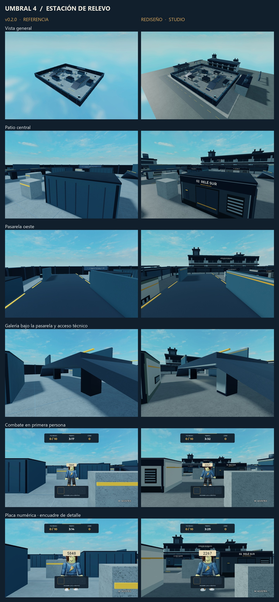

# Estación de Relevo · Informe de dirección artística

La arena representa el patio de transferencia de una subestación cuyo suministro auxiliar sigue activo. Los rótulos de circuito aislado, mantenimiento y salida sellada cuentan qué ocurrió en el recinto y sirven para nombrar posiciones durante la partida. El rediseño parte de `8194a2ecfe39af101bd6d9478b99f8b480d20f40`, la revisión de v0.2.0 usada como base del [PR #1](https://github.com/Pochonski/umbral-4/pull/1).



## Auditoría y cambios artísticos

| Zona | Observación en Studio | Intervención |
| --- | --- | --- |
| Patio central | Los módulos tenían volúmenes uniformes y las vistas largas carecían de un punto de referencia. | La celda 04 se identifica con un panel ámbar, señalización de maniobra y hormigón claro. La nave norte orienta desde el exterior. |
| Seis módulos | Los colores y perfiles de esquina aportaban poca información sobre su función. | Relé Norte, Relé Sur, Control, Potencia, Taller y Refrigeración reciben fachadas con juntas, puertas selladas, lamas e indicadores. |
| Rampas y pasarelas | Las plataformas y pilares se leían como bloques. Las zonas cubiertas eran poco diferenciadas. | Vigas longitudinales, cartelas, perfiles de acero, conductos, remates y difusores. Las marcas ámbar señalan los accesos y los bordes abiertos. |
| Límite del recinto | Desde la arena se veía principalmente cielo por encima del muro. | Zócalos y paneles de servicio dentro del perímetro. Explanada, vial, nave, torres y anexos fuera del perímetro competitivo. |
| Luz | Iluminación a las 14.2 con brillo 2.4 y sin efectos en Lighting. | Luz de las 15.65, relleno suave en sombras y una atmósfera ligera. Corrección de color moderada y bloom de intensidad 0.08. Dos luminarias de galería de alcance corto, con sombras desactivadas. |

El acero azul oscuro organiza la estructura, el hormigón y el blanco industrial dan contraste, y el ámbar se reserva para indicaciones de seguridad. El cian marca equipos en servicio. Se usaron piezas y materiales nativos editables. Las superficies pequeñas aprovechan los materiales de Roblox y las uniones modeladas. Las primeras capturas revelaron rótulos deformados a distancia. Se corrigieron las proporciones con `SurfaceGuiSizingMode.PixelsPerStud` y se dio a la rotulación un plano con separación de su soporte. [Iluminación de Roblox](https://create.roblox.com/docs/environment/lighting) · [SurfaceGui](https://create.roblox.com/docs/reference/engine/classes/SurfaceGui)

Los módulos se mantienen sellados. La vista interior documenta la galería transitable que ya existía bajo la pasarela, junto con sus accesos. Los indicadores y los equipos exteriores comunican ambiente mediante luz y geometría estática.

## Integridad competitiva

- Se conservaron los 112 volúmenes consultables de la arena. La comparación del modelo completo confirmó 123 piezas físicas o consultables con el mismo tipo, posición, tamaño, orientación y propiedades físicas.
- Los 12 puntos de aparición de combate, la llegada del vestíbulo y `PlayableBounds` coinciden con la referencia. El volumen mantiene centro `(0, 14, 0)` y tamaño `(122, 68, 104)`.
- Las piezas añadidas están ancladas y tienen `CanCollide`, `CanTouch` y `CanQuery` desactivados. El complejo exterior es un modelo hermano de la arena. La consulta de visibilidad sigue usando el filtro de la arena y el código Luau de producción tiene el mismo contenido que el de la referencia.
- Studio encontró ocho rutas en ambos lugares con idénticos recuentos de puntos de paso, cuatro rampas, dos galerías y dos corredores. La misma función que usa el juego aceptó la placa frontal y rechazó tanto la placa de espaldas como el rival cubierto.
- Los 12 marcadores tienen suelo debajo y están dentro del volumen. El área de holgura del punto 03 se solapa con la envolvente de una baliza en ambos modelos. Se conservó su ubicación. Queda por comprobar su comodidad al arrancar con un avatar y teclado.

## Combate y reproducción

La suite real de dos clientes de Studio terminó con `[UMBRAL QA COMPLETE] PASS`. Verificó inscripción, marcador, protección de reaparición, ocultación por ángulo y cobertura, rechazo del código recordado tras perder visión, límite de ráfagas, una eliminación mediante VirtualInput, foco del HUD y cámara, descarte de solicitudes inválidas, reaparición con código nuevo, siguiente ronda y abandono por falta de participantes. Las pruebas Luau de reglas y entrada dieron 11 casos aprobados. Dos compilaciones de Rojo resultaron idénticas byte por byte y se comprobó que incluyen los ocho scripts de producción y omiten el entorno de QA.

```pwsh
rojo build default.project.json -o Umbral4-Estacion-de-Relevo.rbxlx
rojo build default.project.json -o Umbral4-rebuild.rbxlx
rojo sourcemap sync.project.json -o sourcemap.json
python -B tests/verify_arena_art.py 8194a2e
python tests/verify_place.py Umbral4-Estacion-de-Relevo.rbxlx Umbral4-rebuild.rbxlx sourcemap.json
```

Ejecuta `tests/check_arena_in_studio.luau` con MCP en el modelo Edit de ambos lugares para repetir la revisión de rutas, puntos de aparición y visión. El procedimiento de combate usa el [lugar de QA y la prueba multicliente de v0.2.0](pruebas-v0.2.0.md). El arte editable reside en `map/EstacionDeRelevo.rbxmx` y la luz global en `default.project.json`. Para ver el arte y la iluminación juntos, abre la compilación completa. El manifiesto de sincronización mantiene su alcance en los scripts.

## Rendimiento

Se midió un cliente de Studio en primer plano con ambas compilaciones de Rojo, en el mismo equipo (Ryzen 5 5600G, RTX 5060), viewport de 1685 × 1113 y calidad automática. Cada toma usa FOV 70, 0,85 s de estabilización y 150 cuadros. La muestra compara el coste de renderizar la escena sin rivales. Se descartaron las corridas con la ventana en segundo plano o con un viewport distinto.

| Vista | Cuadro p95, ms referencia → arte | CPU de render p95, ms | GPU de render p95, ms | Llamadas de escena, media | Triángulos, media |
| --- | ---: | ---: | ---: | ---: | ---: |
| General | 17,97 → 17,79 | 5,05 → 5,65 | 0,95 → 1,03 | 8 → 15 | 2.940 → 9.318 |
| Patio | 18,10 → 17,72 | 5,13 → 5,46 | 0,82 → 0,52 | 8 → 17 | 1.404 → 5.006 |
| Pasarela | 18,39 → 17,81 | 5,29 → 5,46 | 0,91 → 0,46 | 8 → 13 | 924 → 3.414 |

Las medianas por cuadro estuvieron entre 16,63 y 16,70 ms. El rediseño aumentó las llamadas de dibujo y la geometría, con un coste de render bajo en esta sesión. Las diferencias de tiempo por cuadro son pequeñas para afirmar un cambio de FPS a partir de esta muestra. Repite la medición con `tests/measure_arena_in_studio.luau` en el cliente de Play, dejando el lugar activo en primer plano durante toda la muestra. [Contadores de Studio](https://create.roblox.com/docs/reference/engine/classes/Stats)

Las piezas de todo `UmbralWorld` pasaron de 273 a 713. Las 123 de colisión, contacto o consulta conservan la misma geometría. El resto aporta fachada, ambiente o soporte de rótulos. El contraste de la placa se revisó en las capturas de dos clientes automatizados. Quedan pendientes movimiento físico con personas, distancias largas con distintos avatares y lectura en equipos de gama baja. Las mediciones de un cliente tampoco cubren una partida de ocho jugadores.

## Capturas y revisión

Las cuatro vistas de entorno usan las mismas cámaras en ambos lugares. Las dos vistas de combate se capturaron en el cliente de una partida local con jugadores de Studio a 14 studs, pose frontal y el HUD original. La quinta usa FOV 70 y la sexta FOV 45 para acercar la placa. Los códigos se asignaron por el juego. Las capturas de combate automatizadas aportan evidencia visual y la prueba con personas sigue pendiente.

Recomendación. Revisar el arte en el lugar local y hacer una sesión de dos jugadores con teclado y ratón. Priorizar la lectura al pasar entre sombra y sol, las cuatro rampas, las entradas a galerías y el primer paso desde el punto 03. Para evaluar el margen gráfico en hardware modesto, repetir el benchmark a resolución y calidad fijadas.
