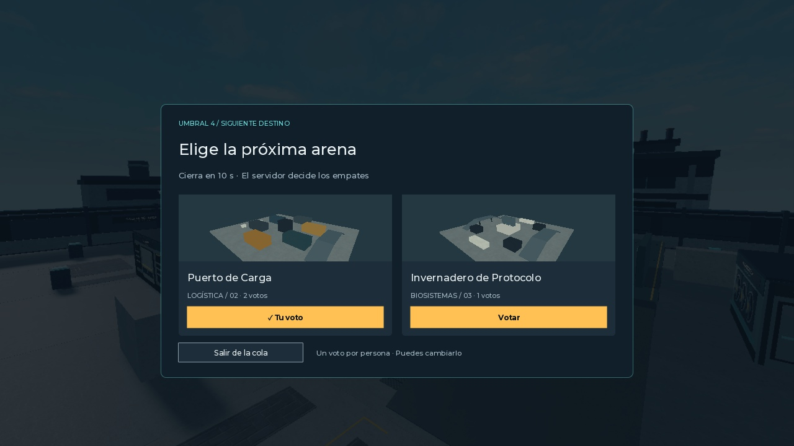
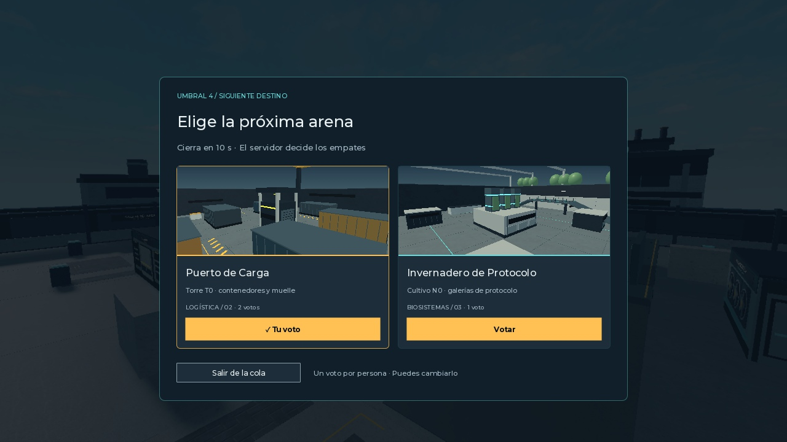
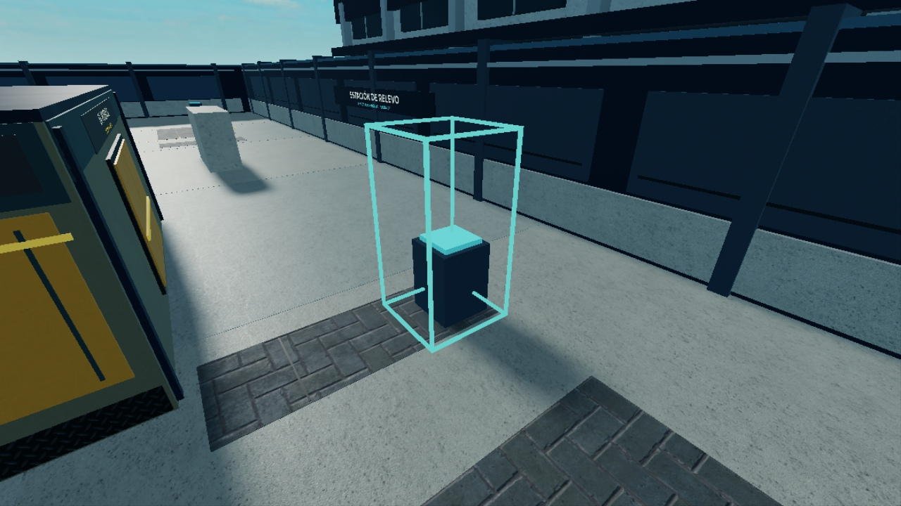
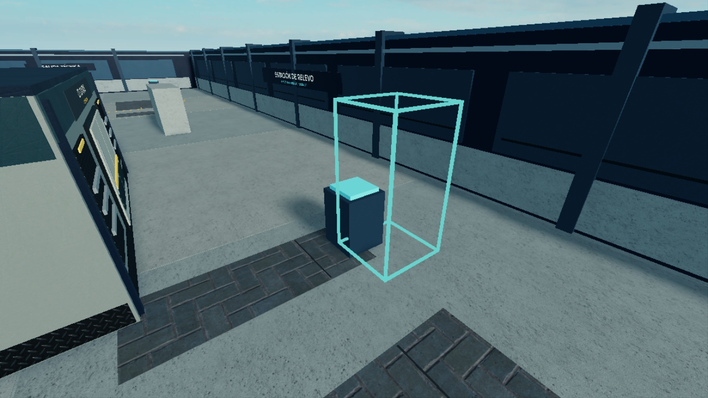

# Umbral 4 — Refinamiento de miniaturas y transiciones

Informe técnico dirigido a ChatGPT. Base revisada: `3b4f8f3`, PR #4. Fecha: 18 de noviembre de 2026.

## Resultado y alcance

La votación conserva su arquitectura y gana vistas de los puntos de referencia, tarjetas más amplias y una corrección de carga tardía reproducida contra la versión anterior. Los tres mapas, los marcadores de aparición, los controles, la cámara de combate y la autoridad del servidor permanecen sin cambios. La evidencia de integridad compara sus fuentes con la base aprobada.

La validación de red de esta pasada usa **un cliente real y un servidor local en procesos separados**, con `MinPlayers=1` exclusivamente en la copia QA. Es una prueba real del transporte y de cuatro rondas de votación/carga; **no es un combate entre dos oponentes**. El intento de dos clientes se detuvo por memoria. No se presentan como ejecutadas las pruebas con personas, ocho clientes, hardware modesto ni combate multicliente bajo latencia.

El PR #4 debe permanecer abierto en borrador. No se publica en Roblox ni se fusiona ningún PR.

[PR #4 y sus comprobaciones actuales](https://github.com/Pochonski/umbral-4/pull/4). El ZIP identifica el commit exacto, la compilación y su hash en `REVISION.json`.

## Miniaturas: diagnóstico y decisiones

La selección anterior conservaba los sólidos de mayor volumen, con un máximo de 42 piezas. Eliminaba casi todos los acabados y muchos elementos distintivos, y el encuadre lejano producía una maqueta pequeña. Las tarjetas tenían 108 píxeles de alto para la vista y poco espacio para explicar qué escenario representaban.

La nueva selección conserva **superficies visibles y relieves**, con un presupuesto de 240 piezas por plantilla. Relevo prioriza Celda 04; Puerto muestra la torre T0, los contenedores y el muelle; Invernadero muestra el núcleo N0 y las galerías. Son subconjuntos de la geometría real: no se inventan edificios para las miniaturas. Una prueba de activos compara sus propiedades con las piezas fuente y comprueba los encuadres de Python y Luau.

Las tarjetas ahora tienen una vista de 344 × 146, nombre, una línea descriptiva, sector y votos. Se conserva el ámbar para la acción y el cian secundario; la selección se reconoce también por el borde y el texto. No hay movimiento continuo ni subida de imágenes a Roblox. El coste se limita a dos vistas 3D durante la votación; las plantillas inactivas no están en Workspace ni participan en raycasts de combate.

`ViewportFrame` no reproduce toda la iluminación y los efectos del escenario. Se usa iluminación de presentación coherente y un fondo degradado discreto. No se presenta la miniatura como una captura con todos los efectos del mundo.

### Comparaciones reales

Capturas reales de Studio, a resolución nativa. La papeleta y sus contadores se fijaron en una **vista sintética de QA** para comparar composición; los botones y modelos son los del módulo real. No son imágenes generadas ni una afirmación de interacción humana.

| Antes, 1280 × 720 | Después, 1280 × 720 |
| --- | --- |
|  |  |

[Antes a 1080p](images/refine-vote-before-1080.jpg) · [Después a 1080p](images/refine-vote-after-1080.jpg) · [Relevo y Puerto](images/refine-vote-relevo-after-1080.jpg).

## Defecto reproducido y corrección

**Fallo:** al recibir el estado de votación antes de `UmbralMapPreviews`, el módulo anterior guardaba `card.mapId` aunque no encontrara el modelo. Al aparecer la carpeta, la misma papeleta seguía vacía. También podía clonar un modelo sin sus hijos y conservar permanentemente esa copia incompleta.

Se reprodujo retirando temporalmente los activos **solo del cliente QA**, aplicando la papeleta y restaurándolos. La versión base dejó cero modelos después de restaurar la carpeta. La regresión de comparación mantiene el módulo y activos anteriores bajo `tests/maps/baseline`; nunca se instalan en el lugar de producción.

**Corrección:** cada plantilla incluye `PreviewPartCount`. La vista solo almacena una copia cuando existen el contador y todas sus piezas. Mientras falta contenido, muestra “Preparando vista…” y reintenta localmente a un máximo de cuatro veces por segundo. Esto es necesario porque, sin votos nuevos, el servidor puede no volver a enviar un estado durante esa votación. Al cargar una vez, los siguientes estados reutilizan la misma copia.

`preview_replication.luau` comprueba contra ambas versiones: carpeta tardía, modelo parcial, recuperación por el temporizador **sin otro estado del servidor** y ausencia de clonaciones repetidas. La base reproduce los fallos y la candidata pasa. Esta corrección afecta a la presentación; el cliente no adquiere autoridad para decidir bajas o posiciones.

## Transiciones y latencia

El arnés recorre Relevo → Puerto → Invernadero → Relevo. Comprueba un único modelo activo, doce marcadores, avatares nuevos dentro de Bounds, retirada del mapa/avatar anterior, personajes en el vestíbulo durante votación, votos por el remoto real y rechazo de mensajes de placas de una ronda anterior enviados deliberadamente por el servidor QA.

El cliente observa cada PreRender y registra generación de placas, estado, revisión, avatar y convergencia. Tiene un margen máximo de dos segundos para converger tras recibir el estado vivo; no se confunde la llegada de un mensaje con la llegada simultánea de toda la réplica. Las comparaciones de tiempos de servidor/cliente usan el reloj sincronizado y tienen precisión limitada por los cuadros.

Perfiles aplicados mediante los seis controles reales de Studio, con lectura de vuelta:

| Perfil | Demora entrada / salida | Variación entrada / salida | Pérdida por dirección |
| --- | --- | --- | --- |
| Sin simulación | 0 / 0 ms | 0 / 0 ms | 0 / 0 % |
| Personalizado | 75 / 75 ms | 5 / 5 ms | 0,2 / 0,2 % |
| 3G de Studio | 150 / 180 ms | 70 / 90 ms | 0,5 / 0,5 % |

La demora configurada no se llama ping medido. Se consultó `Stats.PerformanceStats.Ping` mediante MCP Client con permisos de plugin; el eco del arnés se registra por separado como tiempo de aplicación. La pérdida del simulador está expresada en porcentaje: **0,5 significa 0,5 %, no 50 %**. No se simula límite de ancho de banda.

Las cifras y resultados finales están en [mediciones del refinamiento](refinamiento-mediciones.md), junto con los datos crudos. Los perfiles originales eran cero y el ejecutor los restaura al terminar cada sesión. La compilación no contiene los perfiles ni canales QA.

### Memoria y límites de la prueba

Al iniciar dos clientes, cuatro procesos de Studio dejaron **386.152 KB** libres. Se canceló mediante `StudioTestService.EndTest`, sin forzar el cierre de Studio. En el modo ligero quedaron aproximadamente 2,1–2,4 GB disponibles.

La primera ejecución del arnés ligero completó los pasos de transición pero falló al recoger informes porque aún esperaba un segundo cliente. Se corrigió el **fixture de QA** para recorrer los participantes existentes. Se conserva ese resultado inicial; no se atribuye al juego.

En el modo de un cliente no existe una placa enemiga natural: `enabledPlateFrames=0` es esperado. Se verifica que no se creen placas con los paquetes obsoletos inyectados, pero **la revocación de placas visibles de un oponente a través de una transición con latencia sigue pendiente**. La integración de dos clientes de la entrega anterior permanece como evidencia histórica, no como una prueba nueva de esta candidata bajo latencia.

## Spawn 03 y 09

La consulta conservadora de 2,5 × 5 × 2,5 studs intersecta la base y parte superior de la baliza en Spawn 03, y la base de otra baliza en Spawn 09. Se probó movimiento del Humanoid desde el marcador original, sin modificar el mapa ni desactivar sus colisiones.

| Marcador | Salida hacia el centro | Otras observaciones |
| --- | --- | --- |
| Spawn 03 | 4,19 studs de un destino a 5 | También salió más de 4 studs por −X y +Z; hubo un pequeño ajuste inicial de la posición al asentarse |
| Spawn 09 | 4,37 studs de un destino a 5 | Salió 4,27 studs por −Z; hacia +X chocó con la baliza y avanzó aproximadamente 0,87 studs |

El criterio era disponer de una salida hacia el centro, no atravesar cualquier obstáculo en cualquier dirección. No se reprodujo un encierro completo. La baliza es una pieza física visible: retirarla o desplazarla alteraría la cobertura existente. Por ello **no se movieron marcadores ni balizas**. Se mantiene la comprobación con teclados físicos en el playtest de dos personas. `Humanoid:MoveTo` no se presenta como control humano.





Capturas de Edit con una caja cian **temporal de diagnóstico**, de 2,5 × 5 × 2,5 studs. La caja no colisiona ni se consulta y se retiró después. No es una nueva pieza del escenario ni una captura de navegación humana.

## Revisión de los escenarios

Se revisaron las vistas reales y las fuentes de ambos mapas nuevos frente a Relevo. Puerto e Invernadero siguen siendo más sencillos en densidad de acabados; sus hitos, paletas y rutas ya son distintos. Las miniaturas anteriores exageraban la sensación de bloques al eliminar esos acabados.

Esta pasada concentra la mejora visual en representar los modelos que ya existen. **No se retocan geometría, materiales, iluminación del mundo, rutas ni coberturas.** No se declara equivalencia absoluta de acabado con Relevo. El siguiente criterio debe ser la lectura de placas y el reconocimiento de zonas por jugadores reales, antes de añadir más decoración. Las capturas originales de `puerto-*` e `invernadero-*` siguen representando exactamente los activos actuales.

## Rendimiento y mantenimiento

La comparación de UI utiliza la versión anterior y la candidata en el mismo cliente, con Relevo de fondo y cámara fija, FOV 70, calidades 5/10 y resoluciones nativas 720p/1080p. Alterna A/B dos veces por caso, con tres segundos de calentamiento y diez segundos por muestra. Son 16 muestras del par Puerto/Invernadero. También se registra la creación inicial, las piezas renderizadas y la memoria global del proceso; esta última no se atribuye exclusivamente a las miniaturas porque ambas variantes están cargadas.

La primera tanda quedó limitada por Studio en segundo plano y se conserva como diagnóstico, sin usarla como prueba de FPS del juego. La repetición utiliza una ventana cliente activa en un proceso separado. El montaje del mapa se mide aparte, en servidor inactivo, con nueve activaciones y sin confundirlo con RTT ni con combate.

La comparación final registró p95 de **17,52–18,07 ms** en la candidata y **17,74–18,10 ms** en la base. Los rangos se superponen: no se proclama una mejora de FPS. La aplicación inicial de estado y clonación pasó de **1,45 a 7,80 ms** en una observación por variante, al pasar de 37 a 478 piezas en el par mostrado. Ese coste extra compra representación visual y ocurre al cargar las tarjetas; no se repite con cada voto. La tabla de CPU/GPU y los límites del método se conservan completos.

La validación local final compiló **41 archivos Luau**, analizó los módulos puros, conservó las **17 pruebas** de reglas/entrada/votación y verificó dos builds idénticos, regeneración de activos idéntica y **12 scripts de producción sin QA**. Además compiló los arneses anterior, de transiciones con dos clientes y de transiciones con un cliente. El verificador de contadores contempla la etiqueta XML `int64` que escribe Rojo para `IntValue`.

Compilación: `Umbral4-TresMapas-Refinado.rbxlx`. SHA-256: `628c6fce8fb4230d4c4e8dd478b6ef643638e935eeeb2840bf8bf91d6d4f2579`.

Los límites de CI pasan de 42 a **240 piezas por miniatura**; no son una invitación a añadirlas sin beneficio. `verify_preview_assets.py` valida el presupuesto, contador completo, piezas ancladas sin colisión/consulta/contacto, ausencia de recursos hijos y correspondencia exacta con geometría fuente. `verify_place.py` comprueba además que las plantillas completas y sus contadores existen en la compilación.

**Migración:** reconstruir `default.project.json` completo o actualizar también `ReplicatedStorage.UmbralMapPreviews`. Sincronizar únicamente scripts sobre los activos antiguos no incorpora el contador ni el nuevo contenido. `sync.project.json` mantiene su alcance de scripts.

## Cómo repetir

```powershell
luau tests/rules.luau
luau tests/input_buffer.luau
luau tests/map_vote.luau
python tools/build_previews.py
python tests/verify_preview_assets.py
python tests/verify_new_maps.py
python tests/build_studio_qa.py (Get-Command rojo).Source Umbral4-Transiciones-QA.rbxlx --transitions
python tests/build_studio_qa.py (Get-Command rojo).Source Umbral4-Transiciones-1-QA.rbxlx --transitions-single
```

Usar Servidor y clientes con **2 o 1 clientes según el archivo**, sin mezclar copias. En una ejecución manual, buscar `[REFINE TRANSITION COMPLETE] true` y los pasos de servidor. Los tiempos se aceleran solo en QA. Repetir el modo de dos clientes en un equipo con memoria suficiente. Aplicar el perfil desde el simulador de red de Studio, verificar su lectura y restaurar los valores previos al terminar.

La regresión de miniaturas y el perfil A/B necesitan instalar antes de Play el módulo anterior como `UmbralQABaselineVote` junto a Lobby y el modelo anterior como `ReplicatedStorage.UmbralQABaselinePreviews`; el módulo de prueba apunta a ese nombre. Ejecutar `preview_replication.luau` o `preview_profile.luau` mediante MCP Client. Guardar `RefinePreviewResult` antes de parar y retirar esas copias QA. Todo ese código queda bajo `tests`, fuera del manifiesto de producción.

## Recomendación

**Mantener el PR #4 en borrador.** La mejora de presentación y la corrección de carga tardía son revisables con capturas y regresiones. La prueba de un cliente permite evaluar las transiciones por red simulada, pero no sustituye la pendiente de dos oponentes con placas visibles. Antes de aprobar técnicamente esa parte, repetir `--transitions` con dos clientes en otro equipo y realizar el [playtest humano](playtest-tres-mapas.md), incluyendo Spawn 03/09. Ocho clientes y hardware modesto continúan pendientes. No hay una razón comprobada para cambiar las reglas de combate o reconstruir los escenarios.
