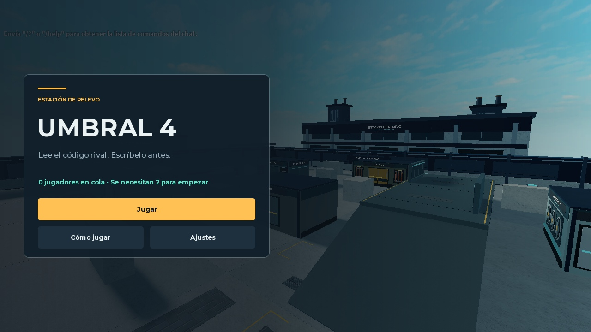
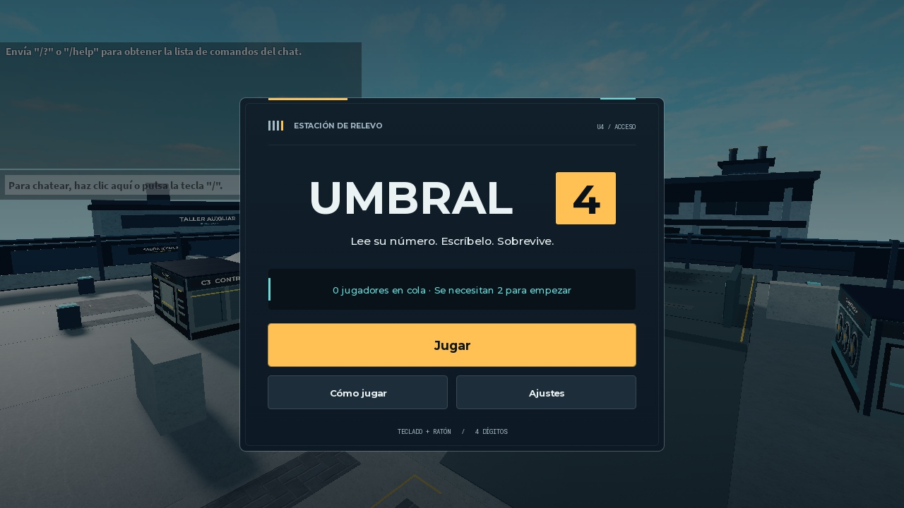
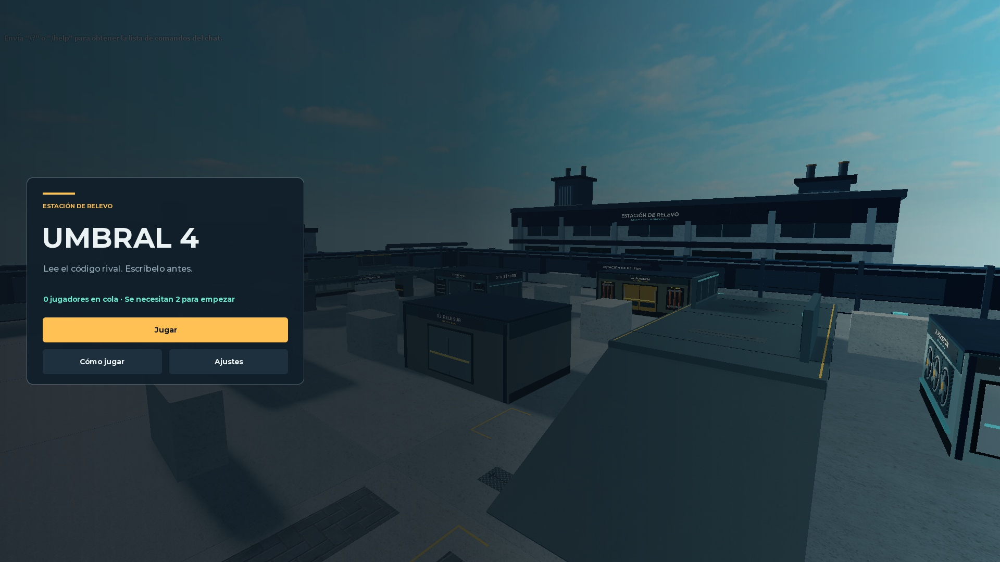
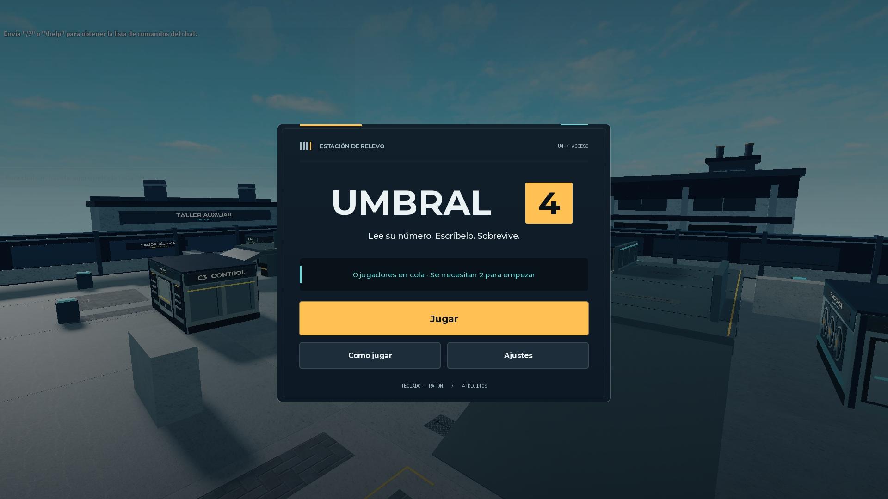
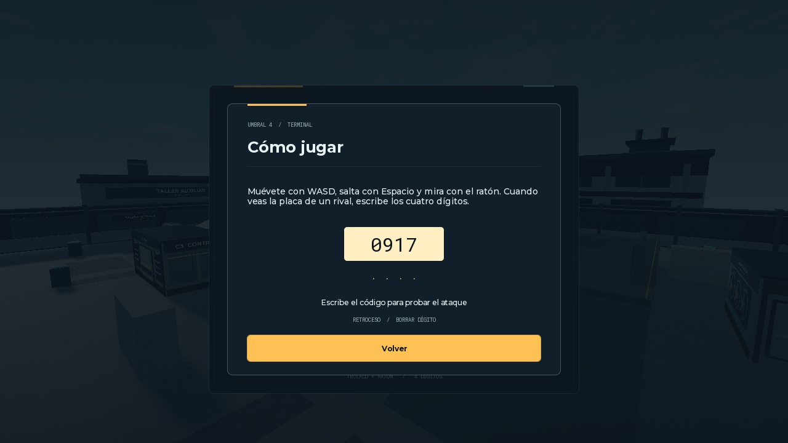
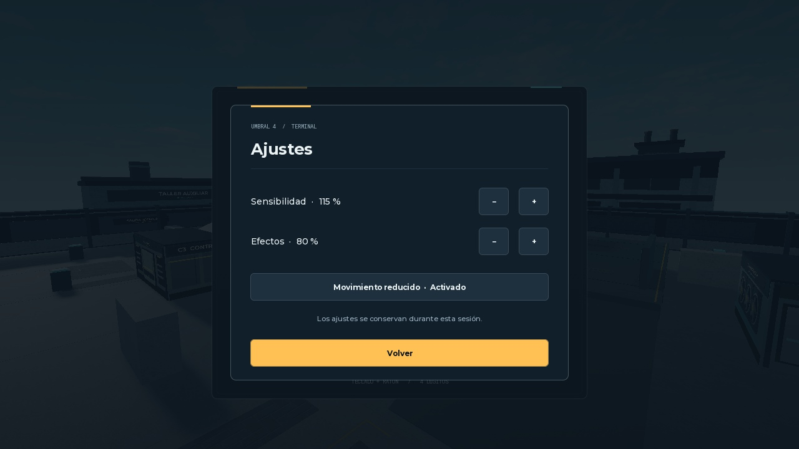
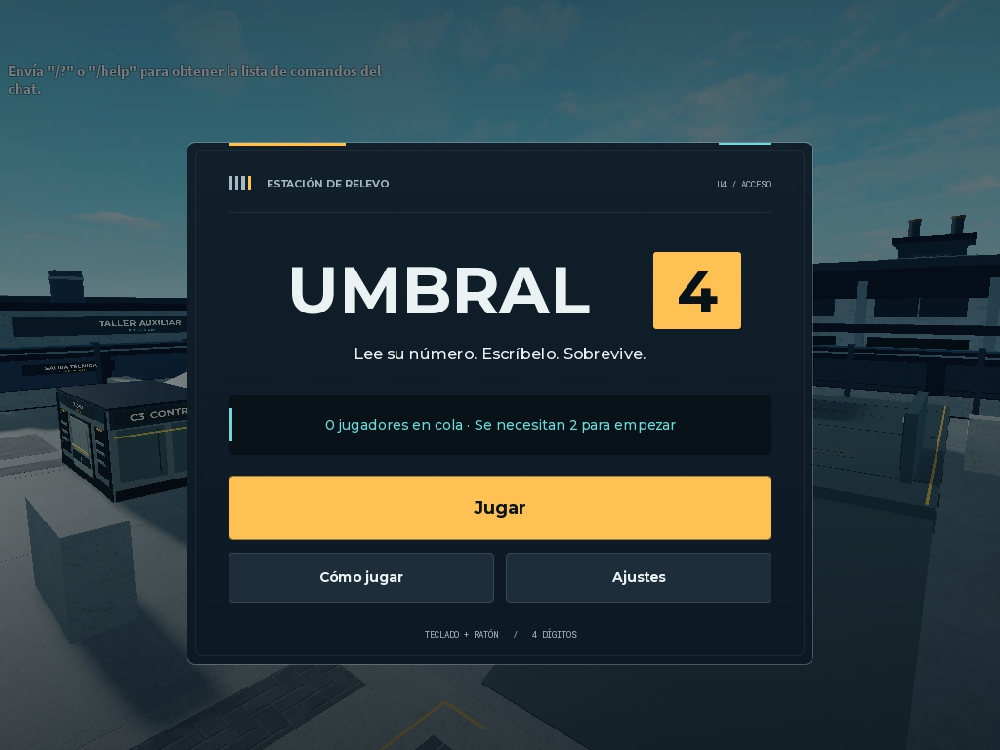
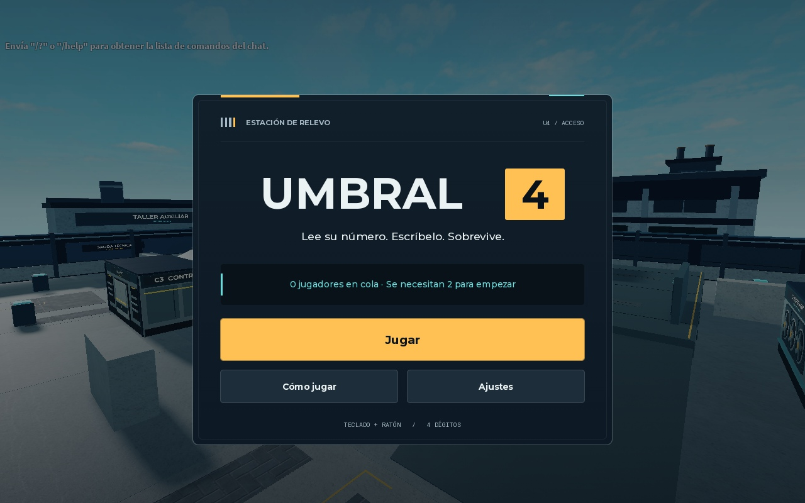

# Terminal industrial · Informe para ChatGPT

## Resultado y alcance

Se implementó la presentación elegida por el propietario: una terminal industrial centrada, con el mapa como fondo secundario. La base es `2909dd1789c8b0b0ecb362729eabb77ad83d8e1d`, cabeza del PR #2 al iniciar. La rama `ui/terminal-principal` conserva el escenario, las coberturas, los puntos de aparición, Lighting y todos los módulos de servidor y compartidos sin cambios.

La candidata está lista para revisión visual. La validación técnica completa permanece abierta hasta ejecutar la integración de dos clientes del menú y recoger una comparación de rendimiento sin otras cargas gráficas. No se publicaron experiencias ni se fusionaron los PR existentes.

## Revisión y trazabilidad

- [PR #3 en borrador](https://github.com/Pochonski/umbral-4/pull/3), dirigido a la rama artística.
- [Commit de implementación 06dd02c](https://github.com/Pochonski/umbral-4/commit/06dd02c205de13321cad262823bc15ab015481cd).
- [GitHub Actions: validación correcta](https://github.com/Pochonski/umbral-4/actions/runs/44189410453) sobre ese commit: compilación Luau, análisis de módulos puros, pruebas y compilación reproducible.
- Los PR #1 y #2 permanecen abiertos en borrador, sin cambios de esta intervención.

## Auditoría de la interfaz anterior

El menú anterior tenía una tarjeta lateral de 462 × 344 unidades, una misma superficie para marca, estado y acciones, tipografía poco diferenciada y controles secundarios muy próximos al botón principal. Su paleta ya era coherente con el juego y la práctica de escritura era útil. Se conservaron ambas, junto con todos los ajustes y la lógica de cola. La cámara elevada presentaba principalmente tejados.

## Decisiones de diseño

- Panel central de 600 × 500 a 720p, hasta 720 × 600 a 1080p. Doble borde fino y un degradado tonal aportan profundidad sin imágenes externas.
- Marca tipográfica en blanco suave y un bloque ámbar para el 4. La frase «Lee su número. Escríbelo. Sobrevive.» comunica la mecánica.
- Estado separado en una franja oscura con acento cian. Se reserva altura para las frases largas y la cuenta regresiva.
- Jugar ocupa todo el ancho útil. Cómo jugar y Ajustes forman una segunda fila con menor contraste.
- Cámara fija en `(37,13,39)`, orientada a `(-6,5,-11)`. Muestra fachadas, accesos y patio; no mueve objetos ni cambia la iluminación del mapa.
- Cómo jugar y Ajustes adoptan el mismo encabezado, materiales visuales, separadores y botón Volver. Se conserva la práctica `0917` y se hace visible la indicación de Retroceso.
- Entrada de 200 ms con desplazamiento de 8 píxeles, y respuesta de borde de 120 ms en botones. Movimiento reducido elimina esas transiciones. No hay animaciones perpetuas, nuevas luces, texturas, audio ni dependencias.

La terminal contiene 39 instancias de interfaz, sin geometría de Workspace. Esta cifra es su inventario, no el incremento neto frente al menú anterior ni una medición de FPS.

## Capturas comparativas

Las parejas antes/después de la pantalla principal son capturas reales del cliente de Studio 0.748.0.7481526, renderizadas a resolución nativa, calidad 10. La interfaz anterior se cargó temporalmente en una sesión local sobre el mapa aprobado y **la misma cámara nueva**, para aislar el cambio de interfaz. No representan la cámara original de v0.2.0. No se modificaron los archivos de la rama artística.

| Resolución | Antes | Después |
| --- | --- | --- |
| 1280 × 720 |  |  |
| 1920 × 1080 |  |  |

| Cómo jugar | Ajustes |
| --- | --- |
|  |  |

| 1024 × 768 | 1280 × 800 |
| --- | --- |
|  |  |

Los controles de Roblox siguen siendo responsabilidad de CoreGui. Las capturas MCP muestran el render del juego; no son fotografías de jugadores humanos usando sus equipos.

## Arquitectura y compatibilidad

`Lobby.luau` contiene la presentación del vestíbulo y la respuesta visual de los botones. `Interface.luau` mantiene el contrato que consume `Main.client.luau`; delega la terminal y conserva HUD, resultados, muerte, práctica y ajustes. El controlador principal solo cambia el encuadre de presentación y recalcula el tamaño cuando cambia el área de la barra superior.

La terminal tiene su propio ScreenGui por debajo de los paneles y el HUD. Los paneles modales bloquean el clic hacia el menú. Las acciones de red, el filtro de dispositivos, la protección contra clics repetidos y el servidor autoritativo se conservan. El escalado del HUD de combate permanece intacto. La sincronización de scripts de Rojo incluye automáticamente el nuevo módulo y no administra el mapa.

Referencias técnicas empleadas: [áreas seguras](https://create.roblox.com/docs/reference/engine/enums/ScreenInsets), [Device Simulator](https://create.roblox.com/docs/reference/engine/classes/StudioDeviceSimulatorService) y [VirtualInput](https://create.roblox.com/docs/reference/engine/classes/VirtualInput).

## Verificación completada

| Prueba | Resultado y límite |
| --- | --- |
| Compilación Luau de producción y pruebas modificadas | Correcta con CLI 0.747 fijada por el proyecto |
| Análisis estático de módulos puros existentes | Sin errores; no equivale a analizar toda la API de Roblox |
| Reglas y buffer de entrada | 7 pruebas de reglas y 4 de entrada correctas |
| Compilación reproducible Rojo 7.7.1 | Dos salidas idénticas; 9 scripts, 12 puntos de aparición, sin instancias QA |
| Integridad del mapa | SHA-256 idéntico al de la base artística |
| Layout | Cuatro resoluciones nativas; 29 elementos de texto comprobados por resolución entre terminal y paneles, sin recortes ni salida del área útil |
| Navegación real de un cliente | VirtualInput activó Cómo jugar, Ajustes y Volver en las cuatro resoluciones |
| Cola real con un cliente | Jugar y Salir de la cola actualizaron el estado a través del servidor de producción |
| Práctica | Código incorrecto, correcto y Retroceso funcionaron mediante VirtualInput |
| Ajustes | Sensibilidad, volumen, movimiento reducido y conservación durante la sesión comprobados |
| Tecla M | Abre y cierra Ajustes; ratón libre en vestíbulo |
| Estados sintéticos | Dispositivo no compatible, cuenta regresiva, cola tardía, combate, muerte, resultados y retorno sin movimiento |

Verificación local: [compilación e integridad](evidence/terminal-build.json).

Evidencias devueltas por Studio: [entrada y layout](evidence/terminal-input-layout.json), [estados sintéticos](evidence/terminal-states.json). La prueba de estados sintéticos no acredita una incorporación tardía real ni una ronda multijugador.

El motor se actualizó automáticamente de 0.747 a 0.748 al reabrir Studio. Se repitieron las verificaciones de cliente en 0.748. La consola mostró un aviso interno de actualización de Assistant/MCP, sin errores de los scripts del menú en esa sesión.

## Rendimiento y pendientes

La medición iniciada antes de la interrupción se perdió al cerrarse Studio. No se conservó una muestra completa comparable y no se utiliza para afirmar mejoras o regresiones. Tras reabrir, había otra carga gráfica activa y alrededor de 2,4 GiB de memoria libre. El propietario indicó que avisará al cerrar ese juego. Se aplazaron las mediciones y el lanzamiento adicional de clientes para preservar estabilidad.

Está preparado `tests/menu_profile.luau`: cámara fija, calidad 10, 15 segundos de calentamiento y tres muestras de 30 segundos por resolución, a 720p y 1080p. Registra mediana y p95 de tiempos de cuadro, CPU y GPU. Los contadores de render incluyen toda la escena; no atribuir una diferencia al menú sin repetir y aislar el origen. Las capturas de alta resolución acreditan presentación, no rendimiento sostenido.

Pendientes explícitos: integración del menú con dos clientes, comparación antes/después recuperable, hardware modesto, ocho clientes y playtest con dos personas. La presentación de entrada tardía está comprobada solo con estados sintéticos en esta entrega.

## Reproducir

Desde la raíz de esta rama, con las herramientas del README:

```powershell
rojo build default.project.json -o Umbral4-Terminal-Industrial.rbxlx
rojo build default.project.json -o Umbral4-Terminal-Verify.rbxlx
rojo sourcemap sync.project.json -o menu-sync.json
python tests/verify_place.py Umbral4-Terminal-Industrial.rbxlx Umbral4-Terminal-Verify.rbxlx menu-sync.json
luau tests/rules.luau
luau tests/input_buffer.luau
```

Para comprobar presentación e interacción, abrir la compilación local, entrar en Play y ejecutar `tests/menu_client_checks.luau` mediante MCP en el DataModel **Client**. Requiere un único jugador en espera y ajustes inicialmente por defecto. Ejecutar después `tests/menu_states.luau` para las comprobaciones con estados sintéticos.

Para la integración de dos clientes:

```powershell
python tests/build_studio_qa.py RUTA_A_ROJO Umbral4-Terminal-QA.rbxlx --menu
```

Abrir exclusivamente esa copia de QA y usar Servidor y clientes con dos clientes. La prueba usa botones mediante VirtualInput, comprueba clics rápidos, cola, práctica, transiciones visuales y continúa con el banco de combate existente. El éxito exige `[UMBRAL QA COMPLETE] PASS` en la salida del servidor. No publicar ni distribuir esa copia como juego; contiene instrumentación y tiempos acelerados.

Para el perfil, ejecutar `tests/menu_profile.luau` mediante MCP en Client. Esperar `workspace:GetAttribute("MenuProfileDone") == true`, comprobar que `MenuProfileError` sea nil y guardar `MenuProfileResult` antes de detener Play. Repetir con la interfaz de `2909dd1` y la cámara común indicada. Mantener Studio en primer plano y el resto de aplicaciones y calidad constantes. Al terminar, detener Play y restaurar el viewport por defecto con `StopSimulationAsync()`.

## Recomendación

**Mantener el PR en borrador para revisión visual.** La navegación de un cliente y la compilación están verificadas. La aprobación técnica final requiere la integración de dos clientes y la comparación de rendimiento pendiente. El siguiente paso es completar esas dos comprobaciones y utilizar el playtest humano ya preparado, sin continuar rediseñando el mapa.
